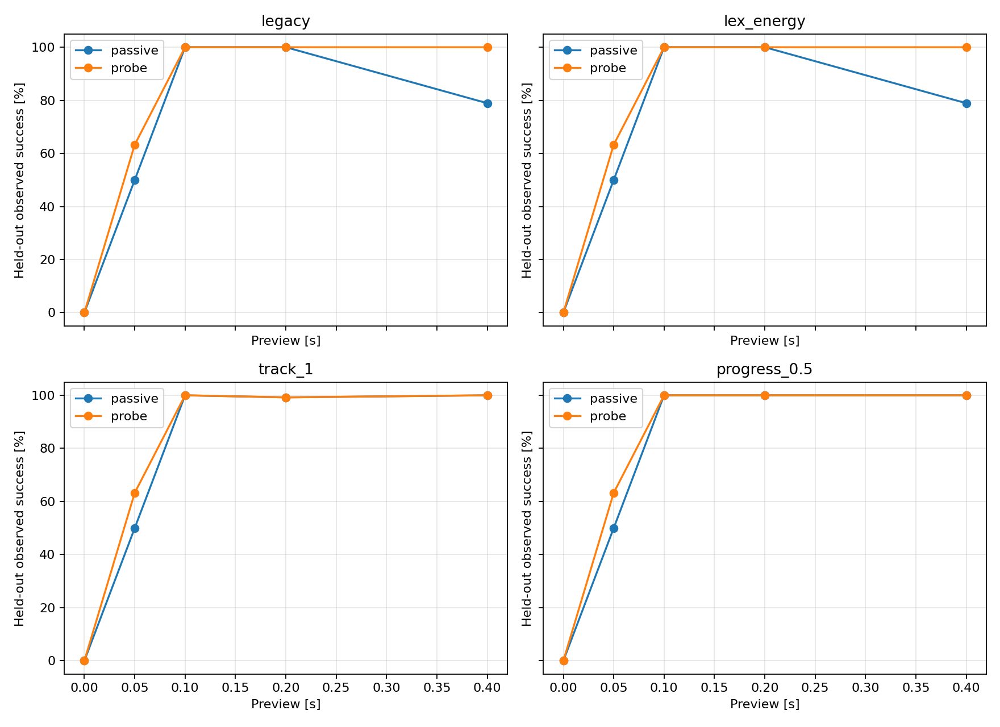

# 被动控制基线敏感性与试探必要性：冻结后测试

日期：2026-11-04。这是一轮基线诊断，不提出新控制算法，也不将有限样本成功称为鲁棒保证。

主要结果：0.4 s 预告下，原始被动基线 101/128，过程跟踪被动基线 128/128，其匹配试探版本 128/128；原先的完成率优势不再出现。0.05 s 下仍有试探版本优势，但所有未知延迟方案都在同样的首步观测后辨识，因此该优势不是辨识时间提前的证据。

## 问题与公平条件

检验上一轮 0.4 s 预告下被动基线下降，是否依赖终点代价和动作时序；再看专门试探相对于改进被动控制器的配对收益。保持原系统、未知固定延迟 d=0/1、误差与外扰边界、绝对目标和截止时间。所有方案输入上限仍为 2 m/s²，准备阶段 |p|≤0.01 m、|v|≤0.06 m/s。预告长度仍为 0/1/2/4/8 步。

每个冻结的被动控制器都有完全匹配的 probe 版本：只有 N>0 时第一步强制 0.1 m/s²，其后两者使用同一控制器和候选筛选。N=0 没有试探，成对控制策略相同。另设 lex_energy 已知延迟参考。真实状态、延迟与外扰不输入未知延迟控制器；状态和指令历史连续，任务开始不重置。

## 预先声明的代价与参数网格

- legacy：原始终点最坏归一化违反量 t + 1e-5·sum|u|。
- lex_energy：先最小化 t，再在 t≤t*+1e-7 下最小化平均 sum|u|。这隔离终点与动作成本的微小权衡；名称 energy 指输入代价，优化的是 L1，不是报告中的平方能量。
- tracking：同样先固定最优终点违反量，再加入过程跟踪误差，权重 0.01/0.1/1。参考轨迹为从零参考状态到同一绝对终点的三次 Hermite 曲线；位置/速度误差以准备边界归一化，使用各候选与未来外扰的最坏分量上界。终点不重复计入过程误差，输入平均 L1 权重为 1e-5。
- progress：终点优先不变，在最后四步的中间状态对偏离参考轨迹超过 0.25/0.5/1 倍准备边界的部分加入软违反代价，权重 0.1；输入权重同上。它不是新增硬路径约束，不改变各方法允许的动作或真实任务要求。

跟踪/进度在每次重规划时取当前剩余中间状态的平均代价，完整公式见 baseline_sensitivity.py。候选过滤与保守未来不确定性包络沿用上一轮。共同开环终点计划不可行时仍执行最小违反动作并记录失败；没有把软化解当成完成证明。

## 开发、冻结与独立测试

8 个候选基线只在旧 37 条轨迹、两个延迟、五档预告上开发，每个配置 370 次，共 2960 次。每个家族按“总完成次数最多 → 平均准备平方能量最小 → 名称顺序”选择一个。所有候选和结果公开，不按测试表现重新挑选。

冻结文件记录源代码、依赖、配置和开发逐案例结果哈希；之后才生成测试输入并运行。测试采用种子 2026110501 的 64 条新有界外扰随机游走和测量误差记录，逐条配两个延迟，每组 128 次，四家族各有 passive/probe，另有一个 oracle，共 5760 次。测试轨迹与开发轨迹逐条检查不重复；测试与开发属于同一生成分布，未改变模型，不声称分布外泛化。测试结果未用于调参或重选配置。

以下先给出开发选择，再给出独立测试和配对结果。Passive-only 是仅被动方案成功的配对数，Probe-only 是仅试探方案成功的配对数。不能只展示试探有利案例。

| Variant | Family | Development successes | Mean prep energy | Selected |
|---|---|---:|---:|---|
| legacy | legacy | 240/370 | 0.0028161 | True |
| lex_energy | energy | 237/370 | 0.0028157 | True |
| track_0.01 | tracking | 257/370 | 0.0162212 | False |
| track_0.1 | tracking | 257/370 | 0.0161850 | False |
| track_1 | tracking | 257/370 | 0.0161806 | True |
| progress_0.25 | progress | 256/370 | 0.0137563 | False |
| progress_0.5 | progress | 256/370 | 0.0093863 | True |
| progress_1 | progress | 240/370 | 0.0028491 | False |

| Preview (s) | Variant | Passive successes | Probe successes | Passive-only | Probe-only |
|---:|---|---:|---:|---:|---:|
| 0.00 | legacy | 0/128 | 0/128 | 0 | 0 |
| 0.00 | lex_energy | 0/128 | 0/128 | 0 | 0 |
| 0.00 | track_1 | 0/128 | 0/128 | 0 | 0 |
| 0.00 | progress_0.5 | 0/128 | 0/128 | 0 | 0 |
| 0.05 | legacy | 64/128 | 81/128 | 0 | 17 |
| 0.05 | lex_energy | 64/128 | 81/128 | 0 | 17 |
| 0.05 | track_1 | 64/128 | 81/128 | 0 | 17 |
| 0.05 | progress_0.5 | 64/128 | 81/128 | 0 | 17 |
| 0.10 | legacy | 128/128 | 128/128 | 0 | 0 |
| 0.10 | lex_energy | 128/128 | 128/128 | 0 | 0 |
| 0.10 | track_1 | 128/128 | 128/128 | 0 | 0 |
| 0.10 | progress_0.5 | 128/128 | 128/128 | 0 | 0 |
| 0.20 | legacy | 128/128 | 128/128 | 0 | 0 |
| 0.20 | lex_energy | 128/128 | 128/128 | 0 | 0 |
| 0.20 | track_1 | 127/128 | 127/128 | 0 | 0 |
| 0.20 | progress_0.5 | 128/128 | 128/128 | 0 | 0 |
| 0.40 | legacy | 101/128 | 128/128 | 0 | 27 |
| 0.40 | lex_energy | 101/128 | 128/128 | 0 | 27 |
| 0.40 | track_1 | 128/128 | 128/128 | 0 | 0 |
| 0.40 | progress_0.5 | 128/128 | 128/128 | 0 | 0 |

| Preview steps | Variant | Policy | Mean prep energy | Max prep p (m) | Max prep v (m/s) | ID by task start | Never ID | Mean ID time among identified (s) | Mean controller ms/episode |
|---:|---|---|---:|---:|---:|---:|---:|---:|---:|
| 0 | legacy | passive | 0.0000000 | 0.000000 | 0.000000 | 0/128 | 0 | 0.0500 | 3.73 |
| 0 | legacy | probe | 0.0000000 | 0.000000 | 0.000000 | 0/128 | 0 | 0.0500 | 3.47 |
| 0 | lex_energy | passive | 0.0000000 | 0.000000 | 0.000000 | 0/128 | 0 | 0.0500 | 5.32 |
| 0 | lex_energy | probe | 0.0000000 | 0.000000 | 0.000000 | 0/128 | 0 | 0.0500 | 5.31 |
| 0 | track_1 | passive | 0.0000000 | 0.000000 | 0.000000 | 0/128 | 0 | 0.0500 | 5.40 |
| 0 | track_1 | probe | 0.0000000 | 0.000000 | 0.000000 | 0/128 | 0 | 0.0500 | 5.32 |
| 0 | progress_0.5 | passive | 0.0000000 | 0.000000 | 0.000000 | 0/128 | 0 | 0.0500 | 5.33 |
| 0 | progress_0.5 | probe | 0.0000000 | 0.000000 | 0.000000 | 0/128 | 0 | 0.0500 | 5.32 |
| 1 | legacy | passive | 0.0062925 | 0.000469 | 0.018771 | 128/128 | 0 | 0.0500 | 5.49 |
| 1 | legacy | probe | 0.0005000 | 0.000149 | 0.005980 | 128/128 | 0 | 0.0500 | 4.28 |
| 1 | lex_energy | passive | 0.0062925 | 0.000469 | 0.018771 | 128/128 | 0 | 0.0500 | 8.22 |
| 1 | lex_energy | probe | 0.0005000 | 0.000149 | 0.005980 | 128/128 | 0 | 0.0500 | 6.09 |
| 1 | track_1 | passive | 0.0062925 | 0.000469 | 0.018771 | 128/128 | 0 | 0.0500 | 8.29 |
| 1 | track_1 | probe | 0.0005000 | 0.000149 | 0.005980 | 128/128 | 0 | 0.0500 | 6.19 |
| 1 | progress_0.5 | passive | 0.0062925 | 0.000469 | 0.018771 | 128/128 | 0 | 0.0500 | 8.25 |
| 1 | progress_0.5 | probe | 0.0005000 | 0.000149 | 0.005980 | 128/128 | 0 | 0.0500 | 6.11 |
| 2 | legacy | passive | 0.0042175 | 0.000719 | 0.010231 | 128/128 | 0 | 0.0500 | 7.83 |
| 2 | legacy | probe | 0.0020144 | 0.000252 | 0.006980 | 128/128 | 0 | 0.0500 | 6.28 |
| 2 | lex_energy | passive | 0.0042175 | 0.000719 | 0.010231 | 128/128 | 0 | 0.0500 | 11.28 |
| 2 | lex_energy | probe | 0.0020144 | 0.000252 | 0.006980 | 128/128 | 0 | 0.0500 | 8.94 |
| 2 | track_1 | passive | 0.0096045 | 0.001011 | 0.014542 | 128/128 | 0 | 0.0500 | 11.38 |
| 2 | track_1 | probe | 0.0122575 | 0.000496 | 0.028469 | 128/128 | 0 | 0.0500 | 8.98 |
| 2 | progress_0.5 | passive | 0.0096035 | 0.001042 | 0.014542 | 128/128 | 0 | 0.0500 | 11.41 |
| 2 | progress_0.5 | probe | 0.0021253 | 0.000225 | 0.006980 | 128/128 | 0 | 0.0500 | 8.95 |
| 4 | legacy | passive | 0.0022335 | 0.000936 | 0.006993 | 128/128 | 0 | 0.0500 | 12.19 |
| 4 | legacy | probe | 0.0012819 | 0.000403 | 0.006980 | 128/128 | 0 | 0.0500 | 10.59 |
| 4 | lex_energy | passive | 0.0022335 | 0.000936 | 0.006993 | 128/128 | 0 | 0.0500 | 18.26 |
| 4 | lex_energy | probe | 0.0012819 | 0.000403 | 0.006980 | 128/128 | 0 | 0.0500 | 15.24 |
| 4 | track_1 | passive | 0.0326944 | 0.002252 | 0.028708 | 128/128 | 0 | 0.0500 | 18.34 |
| 4 | track_1 | probe | 0.1055265 | 0.002252 | 0.051519 | 128/128 | 0 | 0.0500 | 15.37 |
| 4 | progress_0.5 | passive | 0.0144780 | 0.001933 | 0.012694 | 128/128 | 0 | 0.0500 | 18.19 |
| 4 | progress_0.5 | probe | 0.0075033 | 0.000635 | 0.010150 | 128/128 | 0 | 0.0500 | 15.30 |
| 8 | legacy | passive | 0.0017637 | 0.001502 | 0.012683 | 119/128 | 0 | 0.2578 | 28.90 |
| 8 | legacy | probe | 0.0016310 | 0.000701 | 0.006980 | 128/128 | 0 | 0.0500 | 21.15 |
| 8 | lex_energy | passive | 0.0017619 | 0.001502 | 0.012683 | 119/128 | 0 | 0.2578 | 40.33 |
| 8 | lex_energy | probe | 0.0016309 | 0.000701 | 0.006980 | 128/128 | 0 | 0.0500 | 30.02 |
| 8 | track_1 | passive | 0.0328235 | 0.004679 | 0.033066 | 128/128 | 0 | 0.0500 | 34.81 |
| 8 | track_1 | probe | 0.0913889 | 0.004679 | 0.058868 | 128/128 | 0 | 0.0500 | 30.80 |
| 8 | progress_0.5 | passive | 0.0178801 | 0.003475 | 0.012460 | 128/128 | 0 | 0.0500 | 34.48 |
| 8 | progress_0.5 | probe | 0.0137514 | 0.002330 | 0.011830 | 128/128 | 0 | 0.0500 | 30.34 |

能量是准备阶段 dt·sum(u²)，单位 m²/s³；位置/速度偏离为该组准备阶段的实际最大绝对值。辨识时刻是从预告开始到候选首次唯一，平均值仅对已辨识案例计算；同时报告从未辨识数和任务开始前辨识数，避免掩盖删失。时间为每个完整 episode 的过滤和控制耗时，非单步最坏实时保证。两种延迟共享同一轨迹，因此不是 128 个独立随机环境；这里报告有限配对计数，不进行显著性宣称。

## 审计与结论边界

本轮独立测试的关键对照：0.4 s 时 legacy 被动方案为 101/128，冻结的 track_1 被动方案为 128/128，匹配的试探方案为 128/128。对应跟踪被动与试探准备能量分别为 0.0328235 与 0.0913889 m²/s³。这比仅对照原始终点基线更能判断专门试探的独立价值。

测试中准备硬约束求解失败 0 次 episode，实际准备边界违反 0 次 episode；完整原始记录保留。开发与测试共 43600 步均通过独立标量动力学、观测重建、执行延迟、输入界、任务开始连续性、动作能量、状态偏离、终点成败及汇总计数审计。所有保存的观测前缀都保留真实延迟。冻结规则和文件哈希另行核验。

数值边界另存 boundary_diagnostics.json：主成功判据始终沿用终点容差加 1e-10，未为了结果更好而修改。开发中有 18 次、测试中有 0 次失败，在位置和速度分别放宽到仅 1e-8 的数值容限后会通过；它们可能来自 1e-7 归一化词典序松弛，不能当作有实际幅度的性能损失。主表仍保留原始计数。

0.4 s 下各冻结家族的成对差异：legacy: N=8 passive-only=0, probe-only=27; lex_energy: N=8 passive-only=0, probe-only=27; track_1: N=8 passive-only=0, probe-only=0; progress_0.5: N=8 passive-only=0, probe-only=0。这些数字直接显示专门试探在当前家族内的收益或代价；不同家族间也应同时比较。单一终点基线的失败不能作为所有被动控制策略的下界。加入过程跟踪或软进度同时改变了轨迹偏好与信息产生，尚未分离所有机制；本轮没有信息目标或自适应触发器。

0.05 s 下四个家族的被动版本均为 64/128，试探版本均为 81/128；但所有未知延迟方案的唯一候选时刻都是 k=1。首步命令统计另存 first_action_diagnostics.json。既然信息可用时刻一致，就不能把这 17 次净增成功解释成更早辨识；不同首步命令造成的任务开始状态和待执行指令是必须检验的解释。当前证据尚不足以支持“专门主动辨识是必要贡献”。

若某家族在某档预告被动和试探均完成全部有限测试，只能说明本轮没有观察到专门试探的完成率收益；不能证明试探永远无用。若仍有配对优势，也仅针对冻结的候选基线，不是与全局最优因果策略的比较。下一步应先依据这些配对证据限定研究区域，再考虑可恢复任务集合与辨识触发规则，不能把调参结果当作 RA-L 创新。

## 文件与复现

代码 baseline_sensitivity.py 分 development / freeze / test 三阶段；analyze_baseline_sensitivity.py 独立审计并生成图和中英文报告；test_baseline_sensitivity.py 为五项针对性检查。完整回归日志 baseline_sensitivity_tests.log。使用现有虚拟环境和依赖，无新增依赖。

results/baseline_sensitivity/ 保存 config.json、frozen_selection.json、开发和测试各自的 paired_inputs.npz / trajectories.csv / episodes.json / summary.json、测试 provenance.json、audit.json、paired_comparisons.json、report_facts.json 和 heldout_success.png。脚本拒绝覆盖已完成开发/测试结果或重新冻结选择；重现应在独立副本中按 development → freeze → test → analyze 的顺序运行，不修改冻结目录。旧实验代码和结果未改动。

Source SHA-256: `a4eb65cda1f0b734c414ad7ada68529729eff482c0cf5c9ec65556d250b03c38`.

Frozen selection SHA-256: `0d493215d8f4383230a28f7c96452e97cbf68341f946b887ce554118402310ec`.

Python 3.12.14; NumPy 2.3.5; SciPy 1.18.1; scipy.optimize.linprog / HiGHS.

