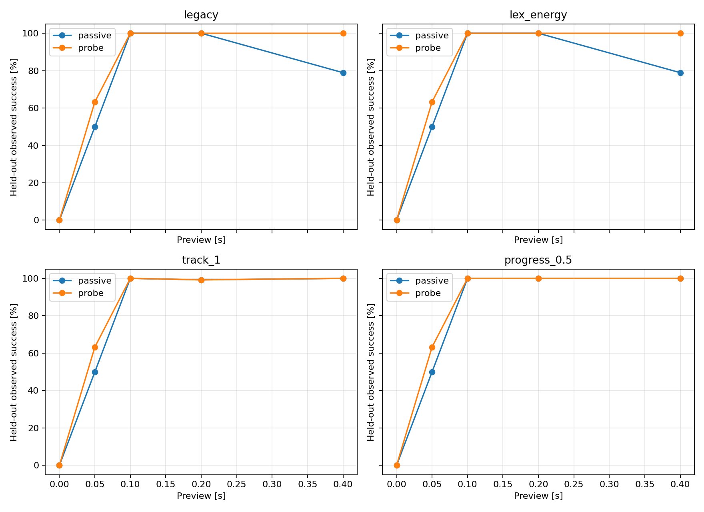

# Passive baseline sensitivity and the need for dedicated probing

Date: 2026-11-04. Baseline diagnosis, not a novel algorithm or a robust guarantee from finite successes.

Main finding: at .4 s, legacy passive achieves 101/128, tracking passive 128/128, and matched tracking probe 128/128. The original completion-rate advantage disappears. At .05 s a probing-version advantage remains, but every unknown-delay controller identifies after the same first observation; it is not evidence of earlier identification.

## Question and matched conditions

Test whether the previous .4 s passive failure depends on endpoint cost and action timing, then compare probing against improved passive controllers. Preserve the plant, unknown fixed d=0/1, uncertainty bounds, absolute endpoint, deadline and preview grid 0/1/2/4/8 steps. Commands remain bounded by 2 m/s²; preparation states satisfy |p|≤.01 m, |v|≤.06 m/s.

Each frozen passive controller has a matched probe version: for positive preview only, force the first command to .1 m/s², then use exactly the same controller/filter. At zero preview they coincide. A lex_energy oracle knows the true delay. Unknown-delay controllers receive no truth states, disturbances, future measurements or execution timestamps. Neither state nor pending commands reset at task start.

## Predeclared variants

Legacy retains t+1e-5·sum|u|, where t is worst normalized terminal violation. Lex_energy first minimizes t, then minimizes average command L1 subject to t≤t*+1e-7. Despite its name, the optimized command cost is L1; reported preparation energy is squared-command energy.

Tracking keeps this lexicographic endpoint priority and adds worst-case componentwise intermediate tracking error, normalized by preparation bounds, at weights .01/.1/1. The reference is a cubic Hermite curve from zero reference state to the same absolute endpoint. Input average L1 has weight 1e-5. The endpoint is not counted again in tracking error.

Progress keeps endpoint priority and penalizes intermediate deviations outside .25/.5/1 times the preparation bounds in the final four steps, with weight .1 and input L1 weight 1e-5. These are soft progress preferences, not additional hard constraints or different action permissions. Intermediate costs are averaged over the remaining intermediate states at each replan; exact coefficients are in baseline_sensitivity.py.

Filtering and conservative future uncertainty envelopes are inherited unchanged. Infeasible robust endpoints use least-violation actions and remain failures when the actual task fails; softened solutions are not certificates of task completion.

## Development, freeze and held-out evaluation

Eight passive variants use the previous 37 records, two delays and five previews: 370 episodes each, 2960 total. Select one variant per family by most total development successes, then least mean preparation squared-command energy, then name. Publish the complete grid, including unselected failures.

The selection manifest binds source/dependency/configuration and development-output hashes. Only after freezing is the evaluation input file generated. Test seed 2026110501 produces 64 new bounded disturbance random walks/error records, paired with two delays, 128 episodes per setting. Four selected families each have passive/probe versions, plus one oracle: 5760 test episodes. No test record duplicates a development disturbance sequence. This is same-distribution holdout, not out-of-distribution generalization. No tuning or reselection uses test outcomes.

Tables show the development selection, held-out success and paired discordances, then costs and identification. Passive-only/probe-only counts retain both directions of benefit.

| Variant | Family | Development successes | Mean prep energy | Selected |
|---|---|---:|---:|---|
| legacy | legacy | 240/370 | 0.0028161 | True |
| lex_energy | energy | 237/370 | 0.0028157 | True |
| track_0.01 | tracking | 257/370 | 0.0162212 | False |
| track_0.1 | tracking | 257/370 | 0.0161850 | False |
| track_1 | tracking | 257/370 | 0.0161806 | True |
| progress_0.25 | progress | 256/370 | 0.0137563 | False |
| progress_0.5 | progress | 256/370 | 0.0093863 | True |
| progress_1 | progress | 240/370 | 0.0028491 | False |

| Preview (s) | Variant | Passive successes | Probe successes | Passive-only | Probe-only |
|---:|---|---:|---:|---:|---:|
| 0.00 | legacy | 0/128 | 0/128 | 0 | 0 |
| 0.00 | lex_energy | 0/128 | 0/128 | 0 | 0 |
| 0.00 | track_1 | 0/128 | 0/128 | 0 | 0 |
| 0.00 | progress_0.5 | 0/128 | 0/128 | 0 | 0 |
| 0.05 | legacy | 64/128 | 81/128 | 0 | 17 |
| 0.05 | lex_energy | 64/128 | 81/128 | 0 | 17 |
| 0.05 | track_1 | 64/128 | 81/128 | 0 | 17 |
| 0.05 | progress_0.5 | 64/128 | 81/128 | 0 | 17 |
| 0.10 | legacy | 128/128 | 128/128 | 0 | 0 |
| 0.10 | lex_energy | 128/128 | 128/128 | 0 | 0 |
| 0.10 | track_1 | 128/128 | 128/128 | 0 | 0 |
| 0.10 | progress_0.5 | 128/128 | 128/128 | 0 | 0 |
| 0.20 | legacy | 128/128 | 128/128 | 0 | 0 |
| 0.20 | lex_energy | 128/128 | 128/128 | 0 | 0 |
| 0.20 | track_1 | 127/128 | 127/128 | 0 | 0 |
| 0.20 | progress_0.5 | 128/128 | 128/128 | 0 | 0 |
| 0.40 | legacy | 101/128 | 128/128 | 0 | 27 |
| 0.40 | lex_energy | 101/128 | 128/128 | 0 | 27 |
| 0.40 | track_1 | 128/128 | 128/128 | 0 | 0 |
| 0.40 | progress_0.5 | 128/128 | 128/128 | 0 | 0 |

| Preview steps | Variant | Policy | Mean prep energy | Max prep p (m) | Max prep v (m/s) | ID by task start | Never ID | Mean ID time among identified (s) | Mean controller ms/episode |
|---:|---|---|---:|---:|---:|---:|---:|---:|---:|
| 0 | legacy | passive | 0.0000000 | 0.000000 | 0.000000 | 0/128 | 0 | 0.0500 | 3.73 |
| 0 | legacy | probe | 0.0000000 | 0.000000 | 0.000000 | 0/128 | 0 | 0.0500 | 3.47 |
| 0 | lex_energy | passive | 0.0000000 | 0.000000 | 0.000000 | 0/128 | 0 | 0.0500 | 5.32 |
| 0 | lex_energy | probe | 0.0000000 | 0.000000 | 0.000000 | 0/128 | 0 | 0.0500 | 5.31 |
| 0 | track_1 | passive | 0.0000000 | 0.000000 | 0.000000 | 0/128 | 0 | 0.0500 | 5.40 |
| 0 | track_1 | probe | 0.0000000 | 0.000000 | 0.000000 | 0/128 | 0 | 0.0500 | 5.32 |
| 0 | progress_0.5 | passive | 0.0000000 | 0.000000 | 0.000000 | 0/128 | 0 | 0.0500 | 5.33 |
| 0 | progress_0.5 | probe | 0.0000000 | 0.000000 | 0.000000 | 0/128 | 0 | 0.0500 | 5.32 |
| 1 | legacy | passive | 0.0062925 | 0.000469 | 0.018771 | 128/128 | 0 | 0.0500 | 5.49 |
| 1 | legacy | probe | 0.0005000 | 0.000149 | 0.005980 | 128/128 | 0 | 0.0500 | 4.28 |
| 1 | lex_energy | passive | 0.0062925 | 0.000469 | 0.018771 | 128/128 | 0 | 0.0500 | 8.22 |
| 1 | lex_energy | probe | 0.0005000 | 0.000149 | 0.005980 | 128/128 | 0 | 0.0500 | 6.09 |
| 1 | track_1 | passive | 0.0062925 | 0.000469 | 0.018771 | 128/128 | 0 | 0.0500 | 8.29 |
| 1 | track_1 | probe | 0.0005000 | 0.000149 | 0.005980 | 128/128 | 0 | 0.0500 | 6.19 |
| 1 | progress_0.5 | passive | 0.0062925 | 0.000469 | 0.018771 | 128/128 | 0 | 0.0500 | 8.25 |
| 1 | progress_0.5 | probe | 0.0005000 | 0.000149 | 0.005980 | 128/128 | 0 | 0.0500 | 6.11 |
| 2 | legacy | passive | 0.0042175 | 0.000719 | 0.010231 | 128/128 | 0 | 0.0500 | 7.83 |
| 2 | legacy | probe | 0.0020144 | 0.000252 | 0.006980 | 128/128 | 0 | 0.0500 | 6.28 |
| 2 | lex_energy | passive | 0.0042175 | 0.000719 | 0.010231 | 128/128 | 0 | 0.0500 | 11.28 |
| 2 | lex_energy | probe | 0.0020144 | 0.000252 | 0.006980 | 128/128 | 0 | 0.0500 | 8.94 |
| 2 | track_1 | passive | 0.0096045 | 0.001011 | 0.014542 | 128/128 | 0 | 0.0500 | 11.38 |
| 2 | track_1 | probe | 0.0122575 | 0.000496 | 0.028469 | 128/128 | 0 | 0.0500 | 8.98 |
| 2 | progress_0.5 | passive | 0.0096035 | 0.001042 | 0.014542 | 128/128 | 0 | 0.0500 | 11.41 |
| 2 | progress_0.5 | probe | 0.0021253 | 0.000225 | 0.006980 | 128/128 | 0 | 0.0500 | 8.95 |
| 4 | legacy | passive | 0.0022335 | 0.000936 | 0.006993 | 128/128 | 0 | 0.0500 | 12.19 |
| 4 | legacy | probe | 0.0012819 | 0.000403 | 0.006980 | 128/128 | 0 | 0.0500 | 10.59 |
| 4 | lex_energy | passive | 0.0022335 | 0.000936 | 0.006993 | 128/128 | 0 | 0.0500 | 18.26 |
| 4 | lex_energy | probe | 0.0012819 | 0.000403 | 0.006980 | 128/128 | 0 | 0.0500 | 15.24 |
| 4 | track_1 | passive | 0.0326944 | 0.002252 | 0.028708 | 128/128 | 0 | 0.0500 | 18.34 |
| 4 | track_1 | probe | 0.1055265 | 0.002252 | 0.051519 | 128/128 | 0 | 0.0500 | 15.37 |
| 4 | progress_0.5 | passive | 0.0144780 | 0.001933 | 0.012694 | 128/128 | 0 | 0.0500 | 18.19 |
| 4 | progress_0.5 | probe | 0.0075033 | 0.000635 | 0.010150 | 128/128 | 0 | 0.0500 | 15.30 |
| 8 | legacy | passive | 0.0017637 | 0.001502 | 0.012683 | 119/128 | 0 | 0.2578 | 28.90 |
| 8 | legacy | probe | 0.0016310 | 0.000701 | 0.006980 | 128/128 | 0 | 0.0500 | 21.15 |
| 8 | lex_energy | passive | 0.0017619 | 0.001502 | 0.012683 | 119/128 | 0 | 0.2578 | 40.33 |
| 8 | lex_energy | probe | 0.0016309 | 0.000701 | 0.006980 | 128/128 | 0 | 0.0500 | 30.02 |
| 8 | track_1 | passive | 0.0328235 | 0.004679 | 0.033066 | 128/128 | 0 | 0.0500 | 34.81 |
| 8 | track_1 | probe | 0.0913889 | 0.004679 | 0.058868 | 128/128 | 0 | 0.0500 | 30.80 |
| 8 | progress_0.5 | passive | 0.0178801 | 0.003475 | 0.012460 | 128/128 | 0 | 0.0500 | 34.48 |
| 8 | progress_0.5 | probe | 0.0137514 | 0.002330 | 0.011830 | 128/128 | 0 | 0.0500 | 30.34 |

Preparation energy is dt·sum(u²), in m²/s³. State excursions are actual maximum absolute preparation positions/velocities in each group. Mean identification time is conditional on eventual identification; never-identified counts and identification by task start are also shown. Runtime covers filtering/control for a whole episode, not a per-step worst-case real-time bound. Two delays share each random environment, so 128 episodes are not 128 independent environments. These are finite paired counts without significance claims.

## Audit and interpretation limits

The key held-out .4 s comparison is legacy passive 101/128, frozen track_1 passive 128/128, and its matched probe 128/128. Tracking passive/probe preparation energies are 0.0328235 and 0.0913889 m²/s³ respectively. This is more informative about dedicated probing than comparison only against the original endpoint baseline.

Test hard-preparation solver-failure episodes: 0; actual preparation-bound violations: 0. Independently audit all 43600 development/test transitions via scalar dynamics, observation reconstruction, delayed application, input bounds, task-start continuity, energy, state excursions, endpoint outcomes and aggregate counts. Every saved prefix retains the true delay. Source/freeze hashes and the predeclared selection ranking are verified separately.

boundary_diagnostics.json separately retains numerical threshold effects. The primary endpoint tolerance plus 1e-10 remains unchanged. There are 18 development and 0 test failures that would pass with componentwise numerical allowances of only 1e-8 m and 1e-8 m/s. Such cases can reflect the 1e-7 normalized lexicographic tolerance and should not be described as material task losses. Main tables keep the original counts.

At .4 s, paired discordances are: legacy: N=8 passive-only=0, probe-only=27; lex_energy: N=8 passive-only=0, probe-only=27; track_1: N=8 passive-only=0, probe-only=0; progress_0.5: N=8 passive-only=0, probe-only=0. Compare across families as well as within each family. A terminal-only controller's failure is not a lower bound on all passive strategies. Tracking/progress change both trajectory preference and information generation; this experiment does not separate every mechanism. No information objective or adaptive trigger has been introduced.

At .05 s, all four passive families achieve 64/128 and their probe versions 81/128. Nevertheless, every unknown-delay controller identifies at k=1. first_action_diagnostics.json records the first-command statistics. The net 17 additional successes therefore cannot be attributed to earlier identification; task-start state and pending-command changes caused by the different first actions must be examined. Current evidence does not establish dedicated active identification as a necessary contribution.

Equal perfect finite-test completion means no observed completion-rate benefit of probing in that setting, not universal uselessness. Remaining advantages concern the frozen candidate controllers, not optimal causal feedback. Use paired evidence to narrow the research region before deriving recoverability/trigger claims; baseline tuning is not a publication novelty result.

## Artifacts and reproduction

baseline_sensitivity.py has development/freeze/test phases. analyze_baseline_sensitivity.py audits and writes figures/bilingual reports. test_baseline_sensitivity.py supplies five targeted checks; full regression: baseline_sensitivity_tests.log. Existing environment, no new dependencies.

results/baseline_sensitivity/ stores configuration, frozen selection, separate development/test paired inputs, trajectories, episodes and summaries, test provenance, audit, paired comparisons, report facts and heldout_success.png. Completed runs and frozen selection cannot be overwritten by the runner. Reproduce in an isolated copy using development → freeze → test → analysis; preserve frozen artifacts. Historical experiments are unchanged.

Source SHA-256: `a4eb65cda1f0b734c414ad7ada68529729eff482c0cf5c9ec65556d250b03c38`.

Frozen selection SHA-256: `0d493215d8f4383230a28f7c96452e97cbf68341f946b887ce554118402310ec`.

Python 3.12.14; NumPy 2.3.5; SciPy 1.18.1; scipy.optimize.linprog / HiGHS.

