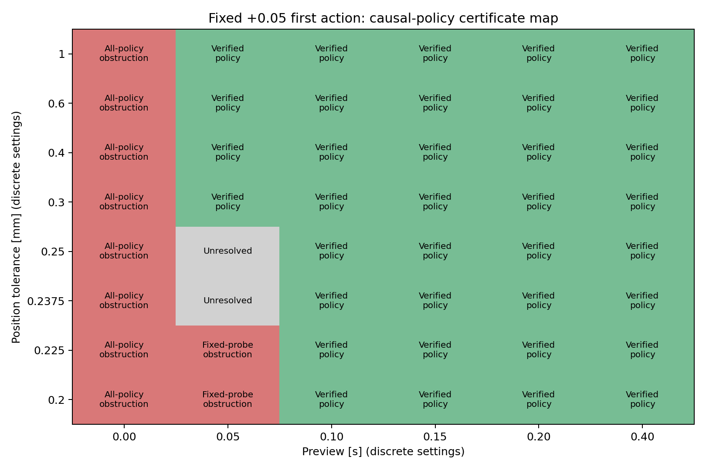

# 因果反馈充分条件：预告时间与任务精度边界

日期：2026-11-04。状态：标准鲁棒仿射反馈构造的数学充分条件与浮点数值证书，不是精确算术机器证明，也不声明论文创新。

## 结果

原位置容差 0.2 mm、速度容差 0.003 m/s 下，0.10 s 预告已构造可执行策略并通过连续不确定集的独立支持函数核验。保持 0.05 s 预告时，放宽位置容差到 0.3 mm 也有证书；速度容差与其他输入、外扰、测量误差边界不变。0.2375 与 0.25 mm 两点只标为尚不能判定，不能当成所有策略不可行。

## 精确的问题范围

沿用双积分器 dt=0.05 s，d=0/1 固定，|u|≤2 m/s²；|w|≤0.02 m/s²，逐步变化≤0.01 m/s²；测量误差逐分量为 (1e-5 m,1e-4 m/s)。目标始终是绝对状态 (0.002 m,0.08 m/s)，截止为预告 N 步加原任务两步。准备状态 |p|≤0.01 m、|v|≤0.06 m/s，包含任务开始状态；无终点后的稳定或持续安全要求。

除原来精确零物理初态外，证书额外覆盖 |p0|≤2e-5 m、|v0|≤2e-4 m/s；这是明确的额外初态扰动覆盖，不能由测量噪声界自动推出。旧物理零初态是其子集。对原零初态下可能的初始测量 y0∈[−ε,+ε]，旧测量盒中的状态也落在这个额外初态范围内。控制器仍只使用测量，不读取真实初态。验证分别报告原零初态与新增扰动，避免混合比较。

## 命题：可核验的充分条件

固定首步 a=+0.05 m/s²。它严格超过保证区分阈值 0.048。根据 y0、y1 和发送指令的候选 LP，k=1 时得到唯一正确延迟。对每个候选分支预先合成下列控制律，实际只执行辨识到的分支：

u0=a；对 k≥1，u[k]=v[d,k]+J[d,k]·(y0/ε)+sum(t=1..k) K[d,k,t]·z[t]。

归一化创新量为 z[t]=(y[t]−A y[t−1]−B u[t−1−d])/s，其中 s=|B|W+ε+|A|ε=(0.00005,0.0012)。由系统方程消去状态和已发输入，可得 z[t]=(B w[t−1]+e[t]−A e[t−1])/s。它只含当前及过去已产生的不确定性，因此 u[k] 不依赖未来；延迟队列完全由已发送历史重建，没有重置。

将初态、外扰和测量误差写成归一化向量 q，满足 Hq≤h：分量盒界与全部 |w[k+1]−w[k]|≤0.01。两个延迟分支的每个输入、准备状态和终点误差都可以写为标量 c+gq。将它除以对应约束界后，要求 |c|+max(Hq≤h)gq≤1。

若对每行存在 λ≥0，Hᵀλ=g、hᵀλ+|c|≤1−m，且 m>0，则所有允许初态、噪声和变化外扰都满足输入/准备/终点要求。证明：λᵀHq≤λᵀh 给出 gq 的统一上界；不确定集中心对称，同时界住负方向；把界代回因果递推即可。唯一延迟判别保证实际选择的是被验证分支。该命题给出有限时域任务保证，不推导递归可行性或无限时域稳定性。

## 计算与独立核验

合成用鲁棒 LP 的对偶变量最大化归一化严格裕度，CLARABEL 只负责求候选解。随后独立用 NumPy 重建状态与输入系数，SciPy/HiGHS 对每行在完整连续 Hq≤h 上重新求最坏支持；检查对偶残差、非负性与因果零结构。最终审计把运行时不使用的未来反馈系数精确置零，重新核验实际执行映射。只有最坏归一化值≤1−1e-7 且数值残差通过时才标为 verified_policy。

本轮 48 个设置中，36 个有独立核验策略，10 个有解析阻碍，2 个尚不能判定。求解器报 infeasible 的两点仍属于未决，因为这里搜索的是限定的仿射策略族，且没有独立核验的全策略不可行证明。8 个点求解器为 optimal_inaccurate，但仍通过独立支持函数核验；不以求解器状态单独认定证书。浮点支持 LP 不是区间算术；严格数值裕度提供可检查证据，但不表述成精确机器证明。

## 不可行区域的作用域

N=0：此前名义模型的必要首动作集合分离，在本图全部容差点排除任何因果策略的确定性任务保证；这是全策略阻碍。

N=1：同前缀 w0=0.02、两条合法未来 (w1,w2)=(0.02,0.02) 与 (0.01,0) 要求同一个后续动作 b。同一个正首步 a 必须满足 b≤(p*+εp−0.00375a−0.000225)/0.00125，同时 b≥(v*−εv)/0.05−a−0.03。合并得 a≤400εp+10εv−0.075。固定 a=0.05、εv=0.003 时必要 εp≥0.0002375 m。因此 0.2、0.225 mm 点对固定首步策略不可保证；即使给控制器真实延迟和精确零初态，这个未来分支冲突仍成立。它不排除采用其他首步动作、允许不唯一延迟的其他策略。

原 0.2 mm 精度下，N=1 的必要界 |a|≤0.035 与保证首步区分的 |a|>0.048 冲突，而 N=2 已有充分策略。因此在“首步保证唯一辨识后控制”的限定方案内，0.1 s 是最短整数采样预告；没有证明它是任意因果未知延迟控制器的全局最短预告。

| Preview (s) | Position tolerance (mm) | Classification | Executable verified margin |
|---:|---:|---|---:|
| 0.00 | 0.2 | proved_obstruction | — |
| 0.05 | 0.2 | proved_obstruction | — |
| 0.05 | 0.225 | proved_obstruction | — |
| 0.05 | 0.2375 | unresolved | — |
| 0.05 | 0.25 | unresolved | — |
| 0.05 | 0.3 | certified_policy | 0.006666666638519558 |
| 0.05 | 0.4 | certified_policy | 0.19574468085004348 |
| 0.05 | 0.6 | certified_policy | 0.21501316943882798 |
| 0.05 | 1 | certified_policy | 0.21501316942635051 |
| 0.10 | 0.2 | certified_policy | 0.15321888409798268 |
| 0.15 | 0.2 | certified_policy | 0.23010752688051905 |
| 0.20 | 0.2 | certified_policy | 0.2301075268514483 |
| 0.40 | 0.2 | certified_policy | 0.23010749469275504 |

| Setting | Initial scope | Validation successes | Max position error (mm) | Max velocity error (m/s) |
|---|---|---:|---:|---:|
| n2_ep02000 | zero | 128/128 | 0.125520 | 0.001841 |
| n2_ep02000 | perturbed | 128/128 | 0.121197 | 0.001942 |
| n2_ep02000 | support_optimizer | 20/20 | 0.169356 | 0.002540 |
| n1_ep03000 | zero | 128/128 | 0.251290 | 0.002258 |
| n1_ep03000 | perturbed | 128/128 | 0.262703 | 0.002268 |
| n1_ep03000 | support_optimizer | 14/14 | 0.298000 | 0.002980 |
| n4_ep02000 | zero | 128/128 | 0.114639 | 0.001402 |
| n4_ep02000 | perturbed | 128/128 | 0.117135 | 0.001612 |
| n4_ep02000 | support_optimizer | 32/32 | 0.153978 | 0.002310 |

Source SHA-256: `e5d992a19461282a1e57c0018d168d4a0ff67e88f56a5f6774413b9be1efd2ac`.

Frozen manifest SHA-256: `13b35ba761203fdb5100a2d349f8774c8911eefc598b4396b5582946230e8dd1`.

## 新轨迹和最坏支持点验证

全部策略和网格分类先冻结并记录源代码、依赖、策略文件哈希，再用新种子 2026110701 生成验证数据。每个选定设置用 64 条原零初态轨迹与 64 条额外扰动初态轨迹，每条配两个真实延迟；另执行支持函数最坏优化点。这些连续集支持点可以同时含边界测量误差、边界初态和变化外扰，不是只抽随机噪声。新随机前缀与上一轮测试检查不重复。

共 834 次实现验证全部通过，3642 步标量物理递推、测量重建、首步候选判别、观测前缀控制重建、输入执行顺序、准备/终点约束、动作能量通过独立审计。没有指令饱和裁剪来掩盖违反。仿真只核验实现；保证证据来自上述连续集条件与支持函数核验。

## 研究意义与限制

当前已得到一个命题、可执行策略和带未决区域的边界图，说明增加预告或放宽精度可以恢复可保证任务。但这主要是标准有限时域鲁棒控制工具对构造例子的应用，不构成 RA-L 创新确认。地图不是全局精确可行域，未决不能涂成不可行，不能把限定策略族的最短预告称为全局最优。继续立论文前需要检查更一般的可恢复任务集合、任务驱动辨识与机器人场景中的非平凡贡献。

## 文件与复现

causal_preview_certificate.py 分 build / validate；analyze_causal_preview_certificate.py 独立核验实际因果策略并生成报告/图；test_causal_preview_certificate.py 包含五项针对性检查。完整测试日志 causal_preview_tests.log。沿用 requirements-reproduction-lock.txt，无新增依赖。

results/causal_preview_certificate/ 保存配置、cells.json、每个已核验策略 NPZ 与支持点、冻结清单、新验证输入/轨迹/逐案例汇总、来源哈希、audit.json 和 causal_feasibility_map.png。build/validate 拒绝覆盖已完成的冻结结果，复现应在独立副本运行。旧实验未覆盖。
