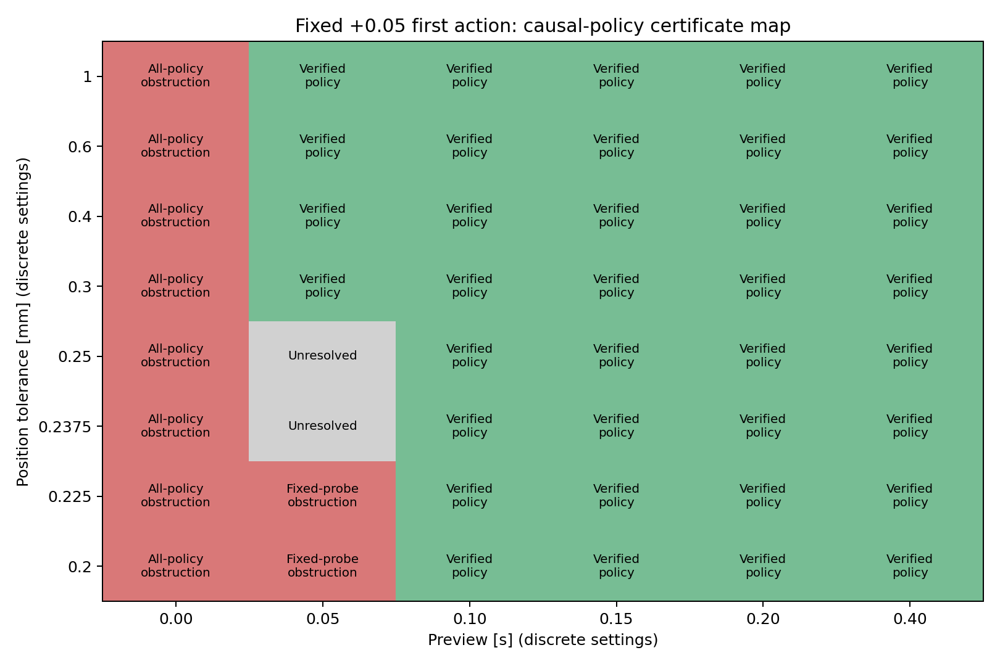

# Causal feedback sufficiency: preview time versus task precision

Date: 2026-11-04. Mathematical sufficient conditions and floating-point certificates using standard robust affine feedback; not an exact-arithmetic machine proof or an originality claim.

## Result and scope

At the original .2 mm position/.003 m/s velocity tolerances, 0.10 s preview admits an executable strategy with independently verified continuous-set support bounds. Keeping .05 s preview and relaxing position tolerance to 0.3 mm also admits one. The .2375 and .25 mm points remain unresolved, not globally infeasible.

Preserve the double integrator dt=.05 s, fixed d=0/1, input bound 2 m/s², disturbance amplitude .02 m/s² and increment .01 m/s², componentwise measurement errors (1e-5 m,1e-4 m/s). The absolute target is (.002 m,.08 m/s), deadline N+2, preparation bounds (.01 m,.06 m/s), including task start. No post-terminal safety or stability requirement is added.

Beyond the original exact zero physical initial state, the certificate explicitly covers |p0|≤2e-5 m and |v0|≤2e-4 m/s. This extra initial perturbation coverage is not inferred automatically from measurement-noise bounds. It contains the original zero state, and for original initial observations y0∈[-ε,ε] it contains their measurement-box states. Control uses measured y0, never true initial state. Validation separates original-zero from additional perturbed initial states.

## Proposition: checkable sufficient condition

Fix u0=a=.05 m/s², strictly above the .048 guaranteed separation threshold. The prefix membership LP identifies the unique correct delay at k=1. For each delay synthesize a branch and execute only the identified one:

u[k]=v[d,k]+J[d,k](y0/ε)+sum(t=1..k)K[d,k,t]z[t], k≥1.

The normalized innovation z[t]=(y[t]−A y[t−1]−B u[t−1−d])/s, with s=(.00005,.0012), equals (B w[t−1]+e[t]−A e[t−1])/s. Thus it contains only uncertainty already generated and the command is causal. Pending inputs are reconstructed from sent history and are not reset.

Normalize initial perturbations, disturbances and sensor errors into q with Hq≤h, including every within-horizon disturbance-rate constraint. Each normalized input, preparation-state or terminal-error row becomes c+gq. If there exists λ≥0 for each row with Hᵀλ=g and hᵀλ+|c|≤1−m for m>0, every allowed realization satisfies the task constraints. Indeed λᵀHq≤λᵀh bounds gq, symmetry bounds its negative, and substitution in the causal dynamics completes the argument. Correct first-step identification selects the verified branch. This is a finite-horizon condition, not recursive feasibility or infinite-horizon stability.

## Synthesis and independent numerical verification

Use a robust dual LP to maximize normalized strict margin with CLARABEL. Independently reconstruct coefficients with NumPy and maximize every support over the entire continuous polytope with SciPy/HiGHS. Check dual residual/nonnegativity and causal zero structure. The final audit projects unused future-feedback slots exactly to zero and rechecks the actual executable map. Acceptance requires an independent worst normalized bound≤1−1e-7 plus residual checks.

Of 48 settings, 36 have verified policies, 10 have analytic obstructions and two are unresolved. Solver infeasibility at the latter two does not prove all-policy impossibility: only a restricted affine family was searched. 8 solves report optimal_inaccurate but pass the independent support checks; solver status alone never certifies a policy. Floating-point LP support is not interval/exact arithmetic. Strict numerical margins provide checkable evidence, not a formal machine proof.

## Obstruction scopes

At N=0, separated nominal necessary first actions rule out a deterministic task guarantee for every causal policy over all plotted tolerances.

At N=1, a shared prefix w0=.02 and future branches (w1,w2)=(.02,.02) versus (.01,0) require a common second action b. Position in the first branch gives b≤(p*+εp−.00375a−.000225)/.00125; velocity in the second gives b≥(v*−εv)/.05−a−.03. Hence a≤400εp+10εv−.075. With a=.05 and εv=.003 this requires εp≥.0002375 m. The .2/.225 mm settings therefore obstruct the fixed-first-action strategy, even with known delay and exact zero initial state. This does not exclude other first actions or policies retaining delay ambiguity.

At the original .2 mm tolerance, the N=1 necessary |a|≤.035 contradicts guaranteed first-step separation |a|>.048, whereas N=2 has a sufficient policy. Thus .1 s is the minimum integer-sample preview in the restricted uniform-first-step-identification scheme, not a proven global minimum over arbitrary unknown-delay causal controllers.

| Preview (s) | Position tolerance (mm) | Classification | Executable verified margin |
|---:|---:|---|---:|
| 0.00 | 0.2 | proved_obstruction | — |
| 0.05 | 0.2 | proved_obstruction | — |
| 0.05 | 0.225 | proved_obstruction | — |
| 0.05 | 0.2375 | unresolved | — |
| 0.05 | 0.25 | unresolved | — |
| 0.05 | 0.3 | certified_policy | 0.006666666638519558 |
| 0.05 | 0.4 | certified_policy | 0.19574468085004348 |
| 0.05 | 0.6 | certified_policy | 0.21501316943882798 |
| 0.05 | 1 | certified_policy | 0.21501316942635051 |
| 0.10 | 0.2 | certified_policy | 0.15321888409798268 |
| 0.15 | 0.2 | certified_policy | 0.23010752688051905 |
| 0.20 | 0.2 | certified_policy | 0.2301075268514483 |
| 0.40 | 0.2 | certified_policy | 0.23010749469275504 |

| Setting | Initial scope | Validation successes | Max position error (mm) | Max velocity error (m/s) |
|---|---|---:|---:|---:|
| n2_ep02000 | zero | 128/128 | 0.125520 | 0.001841 |
| n2_ep02000 | perturbed | 128/128 | 0.121197 | 0.001942 |
| n2_ep02000 | support_optimizer | 20/20 | 0.169356 | 0.002540 |
| n1_ep03000 | zero | 128/128 | 0.251290 | 0.002258 |
| n1_ep03000 | perturbed | 128/128 | 0.262703 | 0.002268 |
| n1_ep03000 | support_optimizer | 14/14 | 0.298000 | 0.002980 |
| n4_ep02000 | zero | 128/128 | 0.114639 | 0.001402 |
| n4_ep02000 | perturbed | 128/128 | 0.117135 | 0.001612 |
| n4_ep02000 | support_optimizer | 32/32 | 0.153978 | 0.002310 |

Source SHA-256: `e5d992a19461282a1e57c0018d168d4a0ff67e88f56a5f6774413b9be1efd2ac`.

Frozen manifest SHA-256: `13b35ba761203fdb5100a2d349f8774c8911eefc598b4396b5582946230e8dd1`.

## Fresh implementation validation

Freeze every policy, classification and source/dependency hash before generating validation inputs (seed 2026110701). Each selected setting uses 64 fresh original-zero and 64 perturbed-initial records, each paired with two delays, plus executable worst-support optimizers. These include boundary sensor errors, initial perturbations and rate-constrained disturbances. Fresh random prefixes are distinct from the previous test.

All 834 episodes pass. Independently audit 3642 transitions through scalar dynamics, measurement reconstruction, causal identification, prefix-only command reconstruction, queue ordering, preparation/terminal constraints and energy. No command clipping conceals violations. Simulation checks the implementation; the continuous-set sufficient condition/support checks supply the guarantee evidence.

## Interpretation and artifacts

The deliverables are a precise sufficient-condition proposition, an executable causal policy and a map retaining unresolved cells. Additional preview or relaxed precision can restore certified performance. This is primarily a standard robust-control construction on a synthetic plant, not confirmed RA-L novelty or a globally exact feasibility frontier. Broader recoverability conditions and a nontrivial robotics contribution remain necessary before claiming a paper contribution.

causal_preview_certificate.py has build/validate phases; analyze_causal_preview_certificate.py audits executable maps and writes reports/figure; test_causal_preview_certificate.py provides five targeted checks. Full regression: causal_preview_tests.log. Existing requirements-reproduction-lock.txt environment; no new dependencies.

results/causal_preview_certificate/ contains config, grid classifications, policy NPZs/support witnesses, frozen manifest, validation inputs/trajectories/episodes/summary, provenance, audit and causal_feasibility_map.png. Completed frozen runs cannot be overwritten by the runner; reproduce in an isolated copy. Historical outputs are preserved.
