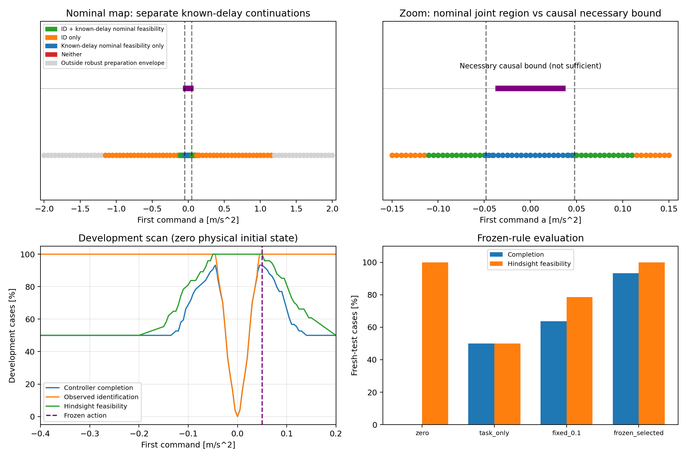

# 首步动作：延迟可辨识性与任务可恢复性

日期：2026-11-04。范围：0.05 s 预告、原两步终点任务的机制分析。没有提出新方法或确认创新。

## 核心结果

旧案例扫描后冻结的首步动作是 +0.050 m/s²；128 条全新轨迹配两个延迟时，完成 239/256，固定 +0.1 为 163/256，原任务控制为 128/256。三个非零方案全部在同一首步后辨识正确，表现差异不能解释为更早获得延迟信息。

名义条件下存在既能区分延迟又允许已知延迟后续控制的动作区域。但考虑全部允许外扰，即使初态精确为零、控制器知道延迟并精确观测状态，也没有能同时保证首步辨识与截止任务的固定首步动作：首步辨识阈值为 |a|>0.048，而任务保证的一个必要条件为 |a|≤0.035。后者是必要条件，不把其内部标成保证可行区域。

## 问题与信息

沿用已有双积分器、dt=0.05 s、延迟 d=0/1 固定、输入 |u|≤2 m/s²、外扰 |w|≤0.02 m/s² 且逐步变化 ≤0.01 m/s²、测量误差 (1e-5 m,1e-4 m/s)。预告只持续一步：k=0 发送首步 a，k=1 原任务开始，k=3 截止。绝对目标 (0.002 m,0.08 m/s)，终点容差 (0.0002 m,0.003 m/s)。准备边界 |p1|≤0.01 m、|v1|≤0.06 m/s。

记录首步产生的真实 x1 与待执行指令 a，此后继续原系统，未重置。所有方案在 k=1、2 使用上一轮 legacy 任务控制器和相同的前缀候选 LP 过滤；诊断用真值单独计算，不传给控制器。测试物理初态固定为零，但控制器只有测量盒；下面分别说明精确零初态的名义几何与测量盒下的一致辨识条件。

## 一、首步辨识阈值

由速度增量得到的两假设加速度区间半径为 W+2ε_v/dt=0.024 m/s²。首步动作使两中心相差 |a|；|a|>0.048 保证区间不相交。另用包含位置和速度的两个世界相容 LP 最大化仍可能共享 y0=0、y1 的正动作，结果也是 0.048。边界点的显式共同观测 y1=(0.00003,0.0012) 同时与两候选相容，故等号不能算保证区分。负方向由对称性得到。这里的阈值对控制器声明的初始测量盒和误差模型成立，不是任意动力学的通式。

## 二、先计算名义已知延迟可恢复性

令后两步动作是 b、c，精确初态零、无外扰，则终点满足：

- d=0：p3=0.00625a+0.00375b+0.00125c，v3=0.05(a+b+c)。
- d=1：p3=0.00375a+0.00125b，v3=0.05(a+b)；c 不在本次期限内执行。

对给定 a 解剩余动作可行性 LP，并将 a 一并作为变量投影，得到 d=0 的区间 [−1.055,0.57]、d=1 的区间 [−0.11,0.11]。d=1 也能独立手算：p3−0.025v3=0.0025a，目标的该线性组合为零，容差组合为 0.000275，因此 |a|≤0.11。

两模型分别已知延迟时都名义可行，并且保证首步区分的联合动作范围为 [−0.11,−0.048)∪(0.048,0.11]。这是两套模型专属后续动作的区域，绝不意味着同一个后续序列可以满足两种延迟。LP 核验本例共同开环 (a,b,c) 集合为空；这本身也不能替代任意反馈策略的不可行证明。

图中的“nominal_task_only”只表示已知延迟后名义任务可行但首步不保证区分，不能标成“无需辨识也能完成”。同理 identify_only 只证明信息可得而两模型中至少一个名义任务不可恢复。

## 三、最坏外扰下的因果限制

首先，d=1 有与 b、c 无关的不变量：

p3−0.025v3 = p0+0.125v0+0.0025a+0.005w0+0.0025w1。

初态测量盒和极值常值外扰给出保证任务的必要界 |a|≤0.041；即便初态精确为零，这一简单不变量也要求 |a|≤0.05。这些只是不变量必要界。

更强的因果证明直接保持本实验的精确零初态：假定控制器甚至已知 d=1，并精确看到共同前缀 w0=0.02 产生的状态。考虑两条均满足幅值与变化率的未来：A 为 (w1,w2)=(0.02,0.02)，B 为 (0.01,0)。在 k=1 选择 b 时两世界信息完全一样，因此必须选择相同 b；k=2 的 c 来不及影响终点。

A 的位置上界要求 b≤1.58−3a；B 的速度下界要求 b≥1.51−a，所以 a≤0.035。对称的负外扰分支要求 a≥−0.035。因此 |a|≤0.035 是本次硬期限任务对全部允许外扰可保证完成的必要条件，即使给了更多信息仍成立。它与保证首步区分的动作集合不相交。

冻结动作 a=0.05 时，两个分支分别允许 b∈[1.430000,1.430000] 和 [1.460000,1.480000]，交集为空。两分支分别在知道未来时可行，但同一个因果 b 无法保证两者。这解释了为什么“每条样本事后可行”不能当成“存在统一的因果保证”。这些推导都是本次构造系统的基础几何，不视作已确认论文贡献。

## 四、开发扫描、冻结与新轨迹测试

粗网格覆盖 [−2,2]、步长 0.05；[−0.15,0.15] 加密到 0.005，补上 ±0.041/0.048/0.355 等诊断点。准备边界按初始测量盒与首步外扰做保守校验，允许区间为 [−1.178,1.178]。不允许点只用于解析地图，不向仿真发送。共 107 个允许动作，每个配旧 37 条轨迹和两个延迟，7918 次开发仿真。

从保证区分且两模型分别名义可行的网格中，按开发完成次数最多、准备平方能量最小、再优先正号，冻结动作 0.05；开发结果 69/74。冻结文件绑定代码、配置和全部开发逐案例数据哈希，冻结后才生成 128 条新有界随机游走外扰与均匀有界误差（种子 2026110601），每条配两个延迟，共 256 次/规则、1024 次新测试。没有使用新测试结果调参。

与零首步、原任务控制首步、固定 +0.1 比较，后续控制器完全相同。新轨迹与开发及上一轮独立测试轨迹均检查不重复；仍是同分布测试，不代表分布外或真实机器人泛化。

| Rule | Mean first action | Success | ID at task start | Hindsight feasible | Known-delay robust plan exists | Hindsight-infeasible failures | Hindsight-feasible failures | Prep energy |
|---|---:|---:|---:|---:|---:|---:|---:|---:|
| zero | 0.000000 | 0/256 | 0/256 | 256/256 | 254/256 | 0 | 256 | 0.0000000 |
| task_only | -0.353946 | 128/256 | 256/256 | 128/256 | 128/256 | 128 | 0 | 0.0062644 |
| fixed_0.1 | 0.100000 | 163/256 | 256/256 | 201/256 | 128/256 | 55 | 38 | 0.0005000 |
| frozen_selected | 0.050000 | 239/256 | 256/256 | 256/256 | 175/256 | 0 | 17 | 0.0001250 |

Source SHA-256: `b0a601c8a26d4bea3841532e63207d5ede5a2ead461508a4555720391702c47f`.

Frozen-rule SHA-256: `41f38c5f530eae7b9dd8bdcaf304a6b84db9f45e23822dfdb9d1ac1178d0b24a`.

Python 3.12.14; NumPy 2.3.5; SciPy 1.18.1; HiGHS via scipy.optimize.linprog.

准备能量为 dt·a²，单位 m²/s³。表中“hindsight”使用真实 x1、真实延迟和已发生的未来外扰计算剩余动作可行性，仅作乐观事后诊断；它的不可行能排除该真实轨迹上的任何后续动作，它的可行不能证明存在可执行的保证策略。“Known-delay robust plan”用当时测量盒及未来外扰包络，假设延迟已知，给出一个共同开环鲁棒后续计划存在的充分证据；它不可行不代表真实任务不可行，候选仍不唯一时它是 oracle 诊断而非控制器可用方案。

## 五、失败归因与验证

原任务首步约 −0.354 后的 128 次失败，全部连真实未来已知的事后 LP 都不可行。固定 +0.1 的 93 次失败中，55 次事后不可行，38 次事后可行。冻结 +0.05 的 17 次失败均事后可行，但当时的保守已知延迟鲁棒计划 LP 不可行。后两类失败只能归为信息/不确定性/控制策略的剩余缺口，不能仅凭事后可行就断言是控制实现错误。零首步 256 次都事后可行，但没有首步辨识，原控制策略全部失败；这也不构成所有未知延迟策略都失败的证明。

独立审计全部 26826 步的标量物理递推、观测、执行延迟、真实候选保留、准备边界、首步能量、任务开始状态/队列、终点成败和汇总计数；冻结规则与源文件哈希另行检查。针对性测试覆盖边界共同观测、名义投影、不变量、可行性层次、队列连续性、生成边界及不可预知未来分支。完整回归记录 first_action_scan_tests.log。

结论：本轮改进主要来自选择同时有信息且较少损害任务的首步动作，而不是辨识时刻更早；0.05 的高有限样本完成率不提供最坏情形保证。下一阶段若继续追求保证，需要改变任务条件（例如增加预告/放宽期限或容差），并显式考虑因果未来分支；不能在当前矛盾的条件下直接声称存在保证式触发算法。任何基于本轮数据调整的方法都需要新的测试。

## 文件

代码 first_action_scan.py（scan → freeze → test），analyze_first_action_scan.py 为独立审计、推导、绘图与报告；测试 test_first_action_scan.py。results/first_action_scan/ 保存 config.json、analytic.json、regions.json、开发/测试输入、轨迹、逐案例与汇总、frozen_rule.json、audit.json、causal_obstruction.json、failure_diagnostics.json、first_action_regions.png。使用现有环境，无新增依赖；已完成运行和冻结选择拒绝覆盖，复现应使用独立副本。旧结果未覆盖。
