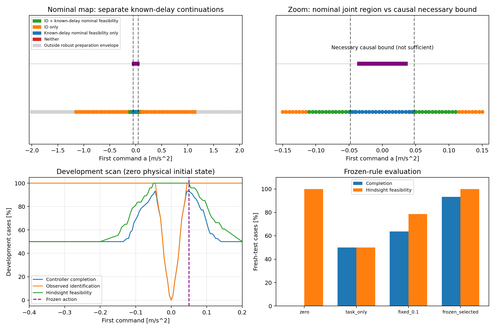

# First action: delay discrimination versus task recoverability

Date: 2026-11-04. Mechanism analysis of the existing .05 s preview/two-step endpoint task. No novel method or verified originality claim.

## Main findings

Freeze a=+0.050 m/s² after scanning development records. On 128 new records paired with two delays it completes 239/256 episodes, versus 163/256 for +.1 and 128/256 for the original task-generated first action. All three nonzero strategies identify after the same first observation. Their different outcomes are not due to earlier identification.

There is a nominal region allowing both discrimination and model-specific known-delay continuation. With all allowed disturbances, however, no fixed first action simultaneously guarantees one-step identification and this deadline task: discrimination requires |a|>.048 under the declared measurement-box model; a necessary causal recovery condition is |a|≤.035, even with exact zero initial state, known delay and exact prefix observation. The latter is necessary, not sufficient.

## Setup

Keep the double integrator, dt=.05 s, fixed d=0/1, command bound 2 m/s², acceleration disturbance bound .02 m/s² and increment .01 m/s², measurement error bounds (1e-5 m,1e-4 m/s). At k=0 apply a, the original task starts at k=1, and the endpoint is k=3. Absolute target (.002 m,.08 m/s), tolerances (.0002 m,.003 m/s). Preparation bounds: |p1|≤.01 m, |v1|≤.06 m/s.

Carry the resulting physical x1 and pending a into the task without resetting. Every strategy uses the same legacy planner and causal prefix membership filter at k=1,2. Ground truth enters only separate diagnostics. Physical test initial states equal zero; controllers only observe bounded-error measurements. Nominal geometry and uniform measurement-box guarantees are distinguished below.

## Observation separation

The acceleration inferred from velocity increments has half-width W+2ε_v/dt=.024 under either hypothesis; |a|>.048 separates them. A two-world LP using both position and velocity maximizes the action for which a shared y0=0,y1 remains possible and obtains exactly .048. At equality y1=(.00003,.0012) is an explicit common observation, so equality is not guaranteed identification. Negative actions follow by symmetry. This threshold is specific to the declared initial measurement box and this plant.

## Nominal known-delay recovery

With exact zero initial state and no disturbance, subsequent commands (b,c) give d=0: p3=.00625a+.00375b+.00125c, v3=.05(a+b+c); d=1: p3=.00375a+.00125b, v3=.05(a+b). The last command c does not reach the delayed plant before the deadline.

LP projection yields a∈[-1.055,.57] for d=0 and [-.11,.11] for d=1. Independently, under d=1, p3−.025v3=.0025a while the target combination is zero and its tolerance is .000275, yielding |a|≤.11.

Thus guaranteed separation and separate known-delay nominal feasibility intersect on [-.11,-.048)∪(.048,.11]. This is not a common continuation sequence: each model may use different b,c. The common nominal open-loop (a,b,c) set is empty, which alone does not prove arbitrary feedback impossibility. The plot label nominal_task_only denotes known-delay nominal feasibility without guaranteed first-step separation, not completion without identification.

## Causal worst-case obstruction

The d=1 invariant is p3−.025v3=p0+.125v0+.0025a+.005w0+.0025w1, independent of b,c. Initial measurement-box uncertainty and constant extreme disturbances require |a|≤.041 for a guarantee; exact zero initial state gives the weaker necessary |a|≤.05.

A stronger nonanticipation argument retains exact zero initial state. Give the controller even more information: d=1 and the exact prefix state. Let w0=.02. Future A is (w1,w2)=(.02,.02), future B is (.01,0); both obey amplitude/rate bounds. At k=1 their information is identical, so b must be shared, and c is too late to help. A's position upper bound requires b≤1.58−3a; B's velocity lower bound requires b≥1.51−a, hence a≤.035. Mirrored negative disturbances give a≥−.035. This is a necessary all-disturbance causal recovery bound, not a sufficiency theorem.

For the frozen action 0.05, the two branch intervals for b are [1.430000,1.430000] and [1.460000,1.480000], with empty intersection. Each future is individually feasible with hindsight, yet no causal b guarantees both. This basic constructed-system geometry is not asserted as a research novelty.

## Development, freeze and fresh evaluation

Use .05 spacing on [-2,2], .005 spacing on [-.15,.15], and diagnostic boundary/actions including ±.041/.048/.355. Uniform preparation-envelope checks give admissible a∈[-1.178,1.178]. Outside points appear only in the analytic map and are not sent to the plant. Scan 107 admissible actions on the previous 37 records and two delays: 7918 development episodes.

Among the separating, separately nominally viable grid actions choose most development completions, then least preparation squared-command energy, then positive sign. Freeze 0.05, development 69/74, with source/configuration/development hashes. Only then generate 128 fresh bounded disturbance random walks/uniform error records (seed 2026110601), paired with two delays: 256 episodes per rule, 1024 total. Compare zero, task-generated, +.1 and frozen action with identical continuation control. Inputs are distinct from development and previous held-out records; this remains same-distribution evaluation. No retuning uses these outcomes.

| Rule | Mean first action | Success | ID at task start | Hindsight feasible | Known-delay robust plan exists | Hindsight-infeasible failures | Hindsight-feasible failures | Prep energy |
|---|---:|---:|---:|---:|---:|---:|---:|---:|
| zero | 0.000000 | 0/256 | 0/256 | 256/256 | 254/256 | 0 | 256 | 0.0000000 |
| task_only | -0.353946 | 128/256 | 256/256 | 128/256 | 128/256 | 128 | 0 | 0.0062644 |
| fixed_0.1 | 0.100000 | 163/256 | 256/256 | 201/256 | 128/256 | 55 | 38 | 0.0005000 |
| frozen_selected | 0.050000 | 239/256 | 256/256 | 256/256 | 175/256 | 0 | 17 | 0.0001250 |

Source SHA-256: `b0a601c8a26d4bea3841532e63207d5ede5a2ead461508a4555720391702c47f`.

Frozen-rule SHA-256: `41f38c5f530eae7b9dd8bdcaf304a6b84db9f45e23822dfdb9d1ac1178d0b24a`.

Python 3.12.14; NumPy 2.3.5; SciPy 1.18.1; HiGHS via scipy.optimize.linprog.

Preparation energy is dt·a², in m²/s³. Hindsight feasibility supplies true x1, delay and realized future disturbances to an optimistic LP. Infeasibility excludes all subsequent actions on that fixed realized path; feasibility does not establish an implementable robust policy. Known-delay robust-plan feasibility uses the current measured box and future disturbance envelope to certify existence of a sufficient open-loop continuation. Its infeasibility is not physical impossibility; when candidates remain ambiguous it is an oracle diagnostic.

## Failure attribution and audit

All 128 failed task-generated-action episodes are hindsight infeasible. Of 93 failures for +.1, 55 are hindsight infeasible and 38 hindsight feasible. All 17 failures for +.05 are hindsight feasible but lack the conservative current known-delay robust-plan certificate. Such gaps include uncertainty/information/planning effects and do not alone prove implementation defects. With zero action all 256 paths are hindsight feasible, but first-step identification never occurs and this controller fails; this does not prove all unknown-delay policies fail.

Independently audit 26826 transitions via scalar dynamics, measurements, delay application, true-candidate retention, preparation bounds, energy, task-start state/queue, terminal outcomes and aggregate counts. Source/freeze hashes and selection ranking are checked. Targeted tests cover boundary overlap, nominal projections, invariant algebra, feasibility layers, continuity, generated bounds and nonanticipating future branches. Full regression: first_action_scan_tests.log.

The observed improvement comes from a more task-compatible informative first action, not earlier identification. High finite-test success at .05 gives no worst-case guarantee. To pursue guarantees, change task conditions such as preview, deadline or tolerances and explicitly handle causal future branches. Do not claim a guaranteed trigger under the present incompatible requirements. Further data-informed changes require fresh evaluation.

## Artifacts

first_action_scan.py runs scan → freeze → test. analyze_first_action_scan.py audits, derives bounds, plots and generates bilingual reports. Tests: test_first_action_scan.py. results/first_action_scan/ stores configuration, analytic boundaries, regions, separate development/test inputs/trajectories/metrics, frozen rule, audit, causal obstruction, failure diagnostics and first_action_regions.png. Existing environment, no new dependencies. Completed runs/freeze refuse overwrite; reproduce in an isolated copy. Historical results are preserved.
