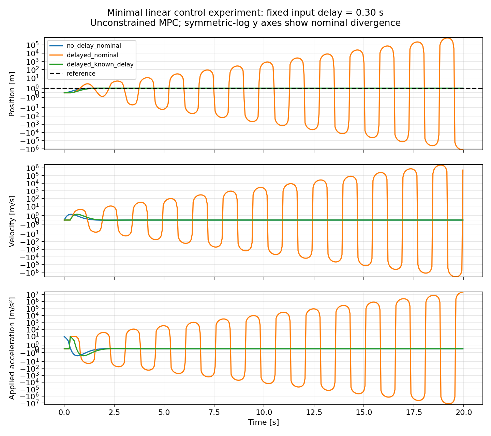

# 实验一：固定输入延迟与已知延迟补偿的基础验证

报告整理日期：2026-11-03。本报告依据已保存的原始结果补写，没有重新运行或修改实验。性质为确定性基础验证，不是拟议论文方法或实机验证。

## 目的

检查无延迟控制、固定输入延迟和已知延迟补偿三种情况下的运动表现，验证动作队列与预测模型的时序是否一致，为后续未知延迟和扰动研究建立参考。主要问题是：忽略输入延迟会怎样影响控制，准确知道延迟后能否恢复收敛？

## 系统与参数

一维双积分系统，状态 x=[位置,速度]，输入 u 为加速度。采样周期 T=0.05 s，采用零阶保持精确离散模型：

```text
p[k+1] = p[k] + T*v[k] + 0.5*T²*u_applied[k]
v[k+1] = v[k] + T*u_applied[k]
```

初始位置、速度均为零，目标为位置 1 m、速度 0 m/s。运行 400 次控制转移，共 20 s；预测时域 40 步，即 2 s。状态权重 Q=diag(20,1)，输入权重 R=0.2，末端状态权重为 Q。

控制器为无约束有限时域线性二次 MPC，通过 Riccati 递推计算首步增益，每个控制周期根据当前状态重新计算动作。没有输入限制、状态限制、外部扰动、测量噪声或随机性。

固定延迟 d=6 步，即 0.30 s：第 k 步发送的动作在第 k+6 步执行。初始等待队列为六个零；零延迟时当前动作立即执行。这里没有时变延迟、包到达冲突或丢包。

## 三组对照

| 工况 | 真实延迟 | 控制器假设 | 信息条件 |
|---|---:|---:|---|
| no_delay_nominal | 0 s | 0 s | 当前完整状态 |
| delayed_nominal | 0.30 s | 0 s | 当前完整状态，忽略动作队列 |
| delayed_known_delay | 0.30 s | 0.30 s | 当前完整状态及准确的待执行动作队列 |

已知延迟组把队列扩展进预测状态。代码直接访问仿真队列作为知情参考方法；这不代表未知延迟控制器能够获取真实队列，也没有实现在线识别。

## 原始结果

| 工况 | 位置 RMSE (m) | 最大绝对位置误差 (m) | 最后记录位置 (m) | 最大绝对发送加速度 (m/s²) |
|---|---:|---:|---:|---:|
| no_delay_nominal | 0.137128 | 1.000000 | 1.000000 | 8.824097 |
| delayed_nominal | 175670.154713 | 1199891.260563 | -1199890.260563 | 23193754.483018 |
| delayed_known_delay | 0.183881 | 1.000000 | 1.000000 | 8.814931 |

指标来自 results/minimal/summary.json，并已根据原始 CSV 核对位置 RMSE。每组记录 400 个转移前状态，时间为 0..19.95 s；20.00 s 转移后状态未写入原始 CSV。因此“最后记录位置”不是恰好 20.00 s 的末状态。位置 RMSE 包含初始瞬态，各记录时刻等权重；最大绝对位置误差也包含起点的 1 m 误差。原实验没有计算正式收敛时间。



图中从上到下为位置、速度、实际执行加速度；黑色虚线为 1 m 目标。三幅纵轴均采用对称对数刻度（linthresh=2），以同时显示发散与收敛轨迹，不能按普通等间距刻度比较。

## 解释与限制

1. 无延迟组到达目标；在当前参数下，忽略 0.30 s 输入延迟导致振荡幅值增长。减速或反向指令尚未执行时，旧指令继续推动系统，造成预测与实际运动不一致。
2. 已知延迟组考虑待执行动作后恢复收敛，但全程 RMSE 高于无延迟组；不能据此声称补偿消除了所有延迟代价。
3. 无约束模型允许巨大加速度，发散组数值不代表真实执行器能力。该现象促使实验二在优化中加入输入约束。
4. 这些结果仅支持当前系统和参数下的观测，不证明所有非零延迟都会导致发散，也不是稳定性或安全性证明。
5. 没有在线延迟估计、学习或置信度机制，不能据此支持论文的新颖性。与实验二/三比较指标时，要考虑本实验无输入约束且只有 400 个记录状态；后两者统计 401 个状态，包含最终状态。

## 检查与复现

experiment.py 的当前 SHA-256 与原始 summary.json 的记录一致。已有 test_experiment.py 包含五项测试：零延迟、固定延迟脉冲、扩展模型与真实队列一致、确定性及已知延迟收敛、非法延迟输入；项目已有测试记录显示通过。

项目根目录 PowerShell：

```powershell
.\.venv\Scripts\python.exe -m unittest -v test_experiment
.\.venv\Scripts\python.exe experiment.py
```

第二条命令会重新生成并覆盖 results/minimal 中对应结果。原运行环境为 Python 3.12.14、NumPy 2.3.5、Matplotlib 3.10.7；详细信息见 summary.json。项目完整环境见 requirements-lock.txt。

## 文件与后续关联

- experiment.py：系统、队列、Riccati 控制与绘图。
- test_experiment.py：五项基础测试。
- results/minimal/no_delay_nominal.csv、delayed_nominal.csv、delayed_known_delay.csv：三组逐步数据；列为时间、位置、速度、位置参考、发送加速度、实际加速度。
- results/minimal/summary.json：参数、环境、源代码哈希及指标。
- results/minimal/delay_comparison.png：对比图。

实验一建立无约束参考；实验二研究输入受限时延迟假设错误的影响；实验三加入外扰和简单在线延迟识别，检查混淆现象。
