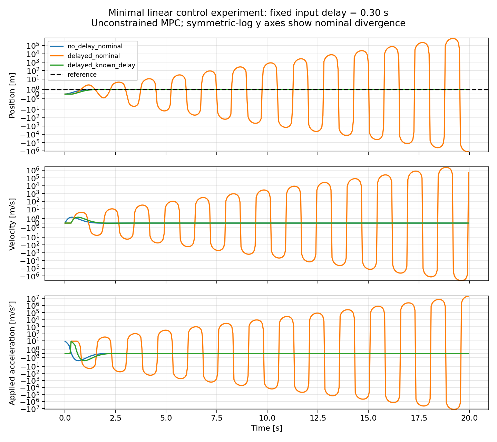

# Experiment 1: Baseline Verification of Fixed Input Delay and Known-Delay Compensation

Report prepared: 2026-11-03. This report documents previously saved results; the experiment was neither rerun nor modified. It is a deterministic implementation check, not the proposed paper method or a real-robot validation.

## Purpose

Compare motion without delay, with ignored fixed input delay, and with known-delay compensation. Check consistency between the command queue and prediction model, establishing references for later unknown-delay and disturbance studies. The central questions are how ignoring input delay affects control and whether accurate delay knowledge restores convergence.

## System and Parameters

The plant is a one-dimensional double integrator with state x=[position, velocity] and acceleration input u. With sampling period T=0.05 s, the exact zero-order-hold discrete model is:

```text
p[k+1] = p[k] + T*v[k] + 0.5*T²*u_applied[k]
v[k+1] = v[k] + T*u_applied[k]
```

Initial position and velocity are zero; the reference is position 1 m and velocity 0 m/s. There are 400 control transitions over 20 s. The prediction horizon is 40 steps (2 s). The state weight is Q=diag(20,1), the input weight is R=0.2, and the terminal state weight is Q.

The controller is unconstrained finite-horizon linear quadratic MPC. A Riccati recursion computes its first-step gain; the action is recomputed from the current state each cycle. There are no input or state constraints, external disturbances, measurement noise, or randomness.

The fixed delay is d=6 steps (0.30 s): a command sent at step k is applied at step k+6. The pending queue initially contains six zeros. With zero delay, the current command is applied immediately. Time-varying delays, packet-arrival conflicts, and packet loss are outside this experiment.

## Three Cases

| Case | True delay | Assumed delay | Available information |
|---|---:|---:|---|
| no_delay_nominal | 0 s | 0 s | Full current state |
| delayed_nominal | 0.30 s | 0 s | Full current state; pending queue ignored |
| delayed_known_delay | 0.30 s | 0.30 s | Full current state and exact pending-command queue |

The known-delay case augments the prediction state with the queue. The implementation directly accesses the simulation queue as an informed reference. This does not imply that an unknown-delay controller can access the true queue, and no online identification is implemented.

## Saved Results

| Case | Position RMSE (m) | Maximum absolute position error (m) | Last logged position (m) | Maximum absolute commanded acceleration (m/s²) |
|---|---:|---:|---:|---:|
| no_delay_nominal | 0.137128 | 1.000000 | 1.000000 | 8.824097 |
| delayed_nominal | 175670.154713 | 1199891.260563 | -1199890.260563 | 23193754.483018 |
| delayed_known_delay | 0.183881 | 1.000000 | 1.000000 | 8.814931 |

Metrics come from results/minimal/summary.json; position RMSE was checked against the original CSV files. Each case logs 400 pre-transition states at times 0..19.95 s. The post-transition state at 20.00 s is not written to the original CSV. Thus, the last logged position is not the terminal state at exactly 20.00 s. Position RMSE includes the initial transient and weights all logged samples equally. Maximum absolute position error also includes the initial 1 m error. The original experiment did not compute a formal settling time.



The panels show position, velocity, and applied acceleration, from top to bottom; the dashed black line marks the 1 m reference. All vertical axes use a symmetric-log scale (linthresh=2) to display both diverging and converging trajectories. They must not be read as ordinary uniformly spaced linear scales.

## Interpretation and Limits

1. The no-delay case reaches the reference. With these parameters, ignoring the 0.30 s input delay causes oscillations of increasing amplitude. Old commands continue driving the plant while braking or reversing commands await execution, creating a mismatch between prediction and actual motion.
2. Accounting for pending commands restores convergence in the known-delay case. However, its full-run RMSE exceeds the no-delay case; compensation cannot be claimed to remove every cost of delay.
3. The unconstrained model permits extremely large accelerations. Values in the diverging case do not represent real actuator capability. This motivated including input constraints in the optimization in Experiment 2.
4. These observations apply to this system and parameter setting. They do not show that every nonzero delay causes divergence and are not proofs of stability or safety.
5. There is no online delay estimation, learning, or confidence mechanism, so these results do not establish paper novelty. Comparisons with Experiments 2/3 must account for the absence of input constraints here and the use of only 400 logged states; those experiments use 401 states including the terminal state.

## Checks and Reproduction

The current SHA-256 of experiment.py matches the original summary.json record. The existing test_experiment.py contains five tests: zero delay, fixed-delay impulse timing, consistency of the augmented model with the physical queue, determinism and known-delay convergence, and invalid delay input. Existing project test records show that they passed.

From the project root in PowerShell:

```powershell
.\.venv\Scripts\python.exe -m unittest -v test_experiment
.\.venv\Scripts\python.exe experiment.py
```

The second command regenerates and overwrites the corresponding files in results/minimal. The original run used Python 3.12.14, NumPy 2.3.5, and Matplotlib 3.10.7; see summary.json for details. The complete project environment is recorded in requirements-lock.txt.

## Files and Relationship to Later Experiments

- experiment.py: system, queue, Riccati controller, and plotting.
- test_experiment.py: five baseline tests.
- results/minimal/no_delay_nominal.csv, delayed_nominal.csv, and delayed_known_delay.csv: three stepwise records, with columns for time, position, velocity, position reference, commanded acceleration, and applied acceleration.
- results/minimal/summary.json: parameters, environment, source-code hash, and metrics.
- results/minimal/delay_comparison.png: comparison plot.

Experiment 1 establishes unconstrained references. Experiment 2 studies incorrect delay assumptions under input constraints. Experiment 3 introduces external disturbance and simple online delay identification to examine ambiguity.
