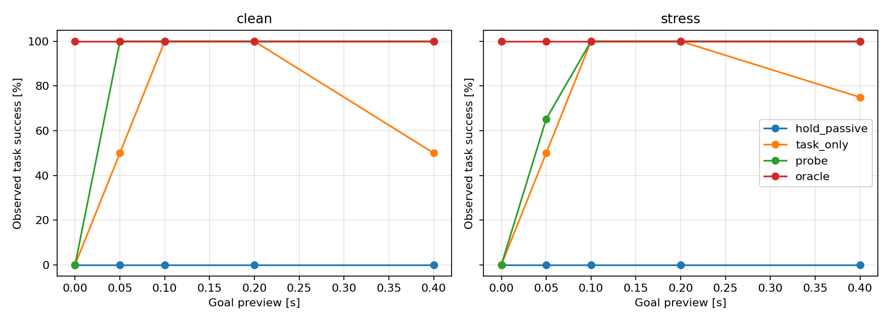

# 预告时间、延迟辨识与任务恢复：实验报告

日期：2026-11-04。性质：构造任务的开发集实验，非独立确认性测试，非新算法或创新性证明。

## 结论

提前预告配合固定试探，能在本轮有限样本中恢复此前冲突任务的完成能力。所有正预告条件下，probe 在首步观测后保留唯一正确延迟；但一个采样周期的预告仍有任务失败。被动任务控制也能通过自身动作辨识：在 2、4 个采样周期时与 probe 同样完成全部测试。因此不能将辨识成功或恢复可行性单独作为主动辨识方法优越性的证据。

## 系统、任务与信息

继承 [问题定义](TASK_AMBIGUITY_PROBLEM_DEFINITION.md)：双积分器 dt=0.05 s，固定未知延迟 d=0/1，输入上限 2 m/s²，外扰幅值 0.02 m/s²、每步增量上限 0.01 m/s²，位置/速度测量误差上限 1e-5 m / 1e-4 m/s。

预告长度 N=0/1/2/4/8 步。用全局索引 k=0 表示预告到来，原任务开始于 k=N，截止于 N+2。目标仍为位置 0.002 m、速度 0.08 m/s，终点误差容限分别 0.0002 m、0.003 m/s。目标是相同的绝对状态，未随预告或初始偏离移动。预告越长，总准备时间越长，故不把效果全部归因于信息。

各方法拥有相同预告、动作上限与准备阶段约束：所有准备阶段状态满足 |p|≤0.01 m、|v|≤0.06 m/s；任务开始的边界状态也计入准备检查。目标任务内没有新增路径约束。仿真从同一个物理零状态出发，控制器只得到带界噪声的测量。历史输入零；延迟候选初始为两个，过滤器只用从当前预告开始的测量前缀，丢弃更早历史是一项保守选择。

## 四组方法

- hold_passive：准备阶段人为保持零输入，任务开始后才进行任务控制及候选更新；它是“等待准备”的参照，不是最强被动控制器。
- task_only：从预告到来就进行任务控制，每步根据测量更新候选，不额外优化可辨识性。任务动作本身可能产生辨识信息，是更重要的对照。
- probe：N>0 时第一步固定发送 0.1 m/s²，随后使用与 task_only 相同的候选过滤和任务控制。N=0 时没有试探，等同 task_only。
- oracle：从第一步知道真实延迟，其余任务控制器与约束相同。仅这组允许使用真实延迟作为控制输入信息；不是全局最优策略。

候选筛选是有界误差线性可行性检查：存在满足所有已观测状态区间、系统方程、外扰幅值/变化率的轨迹才保留候选。真值、执行时间戳、未来观测不输入未知延迟控制器。控制律每步求共同开环计划，最小化归一化终点最坏违反量 t，加 1e-5 倍输入绝对值和以选择动作；准备阶段状态边界作为硬约束。t=0 且残差通过检查，只表示当前求出的计划具有充分的鲁棒终点证据，不等于已证明整套重规划策略递归可行。

未来预测用当前测量误差盒与未来外扰序列的保守乘积包络。双积分器的分量支持由全正/全负常值极值达到，故幅值外包络与未来窗口内的变化率约束给出相同支持；未利用跨当前时刻的外扰相关性。若终点鲁棒可行集为空，仍执行最小违反计划并记录实际成败，不把软化后的解当作任务保证。若准备硬约束 LP 不可行，返回零输入并显式记录失败；本轮这种失败为零。

## 可手算的辨识条件

首步之前发送历史为零。由速度增量估计实际加速度，每个延迟假设的观测区间半径为 W+2ε_v/dt=0.024 m/s²。两区间不相交的充分条件为 |probe|>2W+4ε_v/dt=0.048 m/s²。固定 0.1 超过此界。因此在模型和误差边界成立时，首步即可区分两候选；这与后续任务是否仍可行是两个问题。该结论只针对本例的两个延迟和零历史条件。

## 配对设计与结果

每个预告/方法组合包含 37 条外扰与误差轨迹，分别配两个真实延迟，共 74 次。包括无扰动无噪声、正负极值常值外扰及交替误差、交替外扰、爬坡外扰，以及固定种子 20261104 的 32 条有界随机游走外扰和均匀有界测量误差。四组方法逐案例使用相同真实延迟、初态、外扰和测量误差，共 1480 次；不同预告共享外扰/误差前缀，但截止时间不同。

以下为所有案例的任务完成次数，要求终点容差和准备边界均满足；比例是本构造测试集的观测频率，不是概率保证。

| Preview steps (s) | hold_passive | task_only | probe | oracle |
|---|---:|---:|---:|---:|
| 0 (0.00) | 0/74 (0.0%) | 0/74 (0.0%) | 0/74 (0.0%) | 74/74 (100.0%) |
| 1 (0.05) | 0/74 (0.0%) | 37/74 (50.0%) | 49/74 (66.2%) | 74/74 (100.0%) |
| 2 (0.10) | 0/74 (0.0%) | 74/74 (100.0%) | 74/74 (100.0%) | 74/74 (100.0%) |
| 4 (0.20) | 0/74 (0.0%) | 74/74 (100.0%) | 74/74 (100.0%) | 74/74 (100.0%) |
| 8 (0.40) | 0/74 (0.0%) | 55/74 (74.3%) | 74/74 (100.0%) | 74/74 (100.0%) |

| Preview steps | task_only energy | probe energy |
|---|---:|---:|
| 1 | 0.0062788 | 0.0005000 |
| 2 | 0.0042473 | 0.0019879 |
| 4 | 0.0022747 | 0.0012586 |
| 8 | 0.0012797 | 0.0014615 |

Source SHA-256: `d67eb0f7f5cf3804e001b88084a89ab420fddae0e0329cbb857bd634d1b54839`.

Python 3.12.14; NumPy 2.3.5; SciPy 1.18.1; HiGHS via scipy.optimize.linprog.

能量为准备阶段 dt·sum(u²)，单位 m²/s³，包含全部准备动作，不单独把固定试探算作唯一成本；全部输入序列保留。正预告的 probe 均在 k=1 辨识正确。无准备边界违反，也无准备硬约束求解失败，真实延迟始终保留。

N=1：probe 在干净情况 2/2 成功，但有外扰/误差的 72 次中仅 47 次成功；task_only 对应 1/2 与 36/72。信息已经可用，但状态、队列、期限及控制器保守性仍限制任务完成。N=2 与 N=4：probe 和 task_only 均 74/74；说明任务输入本身在这些设置下足够。

N=8 的 task_only 降至 55/74。干净 d=1 案例准备命令依次为 [-0.00000, -0.00603, -0.01504, -0.01654, -0.01488, -0.01488, -0.01782, -0.02673]，唯一延迟直到 k=9 才获得，已经晚于 k=8 的任务开始。这个现象与当前仅终点代价、无信息目标且含微小输入代价的重规划器相符：它可能推迟动作。不能推断预告越长本质上越差，也不能将此特定控制器的失败当作所有被动方法的下界。oracle 在本轮全部案例完成任务。

## 独立审计与边界

保存后另用标量物理递推审计 1480 次、7400 步：位置/速度转移、测量误差、配对外扰、实际延迟执行、指令历史连续性、任务开始状态、终点与准备指标、汇总计数均通过。物理递推最大残差 8.67e-19。没有在任务开始重置状态或队列。五项针对性测试覆盖延迟队列预测、首步分离、任务开始连续性、生成边界、初始共同计划与已知延迟参考。完整测试见 preview_identification_tests.log。

在已测试的离散预告和有限案例中，probe 最短全部完成点是 N=2（0.1 s）；这不是连续预告时间或所有允许扰动下的最小保证时间。未设计最优试探、任务触发规则、全局最优被动策略或递归可行性证明。结果没有显示 probe 相对强被动基线在所有预告条件下严格更优。所有结果为开发数据，后续方法若据此调整，需要新的独立测试。

下一步应直接比较“无需额外试探即可完成”的区域和“任务动作信息不足”的区域，并引入辨识时间与可恢复任务集合的联系；同时加入被动控制器的代价/时序敏感性对照，避免把等待行为误判为主动辨识的普遍优势。

## 保存与运行

results/preview_identification/：config.json、paired_inputs.npz、trajectories.csv、episodes.json、summary.json、audit.json、preview_success.png。代码 preview_identification.py；审计 audit_preview_identification.py；报告生成 summarize_preview_identification.py；测试 test_preview_identification.py。沿用 requirements-reproduction-lock.txt 的现有环境，无新增依赖。

运行顺序：`.\.venv\Scripts\python.exe -B preview_identification.py`、`.\.venv\Scripts\python.exe -B audit_preview_identification.py`、`.\.venv\Scripts\python.exe -B summarize_preview_identification.py`。完整回归：`.\.venv\Scripts\python.exe -B -m unittest -v`。只写本次结果目录，不重跑旧实验。
