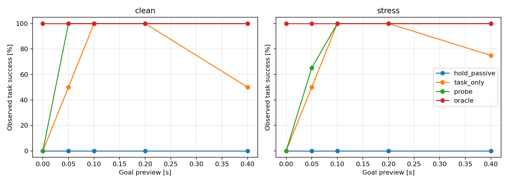

# Goal preview, delay identification and task recovery

Date: 2026-11-04. Constructed development benchmark; not a new identification method or an originality claim.

## Finding

Fixed probing with advance goal notice recovers task completion in the tested cases. Every positive-preview probe episode identifies the correct delay after the first observation, yet one-step preview still permits task failures. Task-only control also identifies through its own actions and matches probe at two- and four-step preview. Identification accuracy or recovery alone therefore does not establish superiority of dedicated active identification.

## Model, information and deadline

Use the existing [problem definition](TASK_AMBIGUITY_PROBLEM_DEFINITION_EN.md): double integrator dt=.05 s, fixed unknown d=0/1, command bound 2 m/s², disturbance bound .02 m/s² and increment bound .01 m/s² per sample. Measurement error bounds are 1e-5 m and 1e-4 m/s. Preview N∈{0,1,2,4,8} arrives at global k=0; the original task starts at k=N and ends at N+2. The absolute target remains (.002 m,.08 m/s), with tolerances (.0002 m,.003 m/s).

All methods share preparation state limits |p|≤.01 m, |v|≤.06 m/s, including the state at task start. No new within-task path constraints are imposed. The physical state initially equals zero; controllers only observe noisy measurements. Historical commands are zero. The prefix filter deliberately discards observations preceding preview, a conservative information choice. Longer preview supplies more preparation time as well as potential information.

## Methods and inference

- hold_passive: hold zero commands throughout preparation, then use task control and candidate updates. This is a waiting reference, not an optimal passive controller.
- task_only: use task control and candidate updates immediately on receiving preview, without a dedicated information objective. Its task actions can identify the delay.
- probe: when N>0 send a fixed .1 m/s² first command, then use the same controller/filter as task_only. At N=0 this equals task_only.
- oracle: know the true delay from the outset; otherwise use the same planner and constraints. This is not a globally optimal reference.

The prefix-only filter retains a delay if some state/disturbance trajectory fits every measured interval, the dynamics and the disturbance amplitude/rate constraints. Evaluation truth, future observations and execution timestamps are excluded from unknown-delay control. Each step solves a common open-loop minimax plan: normalized terminal violation t plus 1e-5 times command absolute sum, with hard preparation state envelopes. A zero-slack verified plan is a sufficient certificate for that plan, not a proof of recursive feasibility of the replanning policy.

Future uncertainty is conservatively bounded by a product of the present measurement-error box and future disturbance sequences. Positive double-integrator component supports are attained by constant extreme disturbances, satisfying the within-future rate limit. Cross-boundary correlations are omitted. When the robust endpoint is infeasible, the least-violation command is executed and actual failures remain in the record. Hard preparation LP infeasibility triggers a logged zero fallback; no such failures occurred here.

## First-step discrimination

With zero command history, the acceleration inferred from velocity increments has half-width W+2ε_v/dt=.024 m/s² under each hypothesis. A command magnitude greater than 2W+4ε_v/dt=.048 separates these intervals. The fixed .1 probe exceeds that bound. This suffices for one-step discrimination under the stated bounds; it does not suffice for task recovery.

## Paired evaluation

Each preview/method has 37 disturbance/error records and two true delays, giving 74 episodes. Records include a clean case, positive/negative extreme constant disturbances with alternating error corners, alternating disturbances, a ramp, and 32 bounded random walks with bounded uniform errors (seed 20261104). Methods share each physical initial state, delay, disturbance and error sequence. Preview settings share sequence prefixes but have different deadlines. Total: 1480 episodes.

Success requires both terminal tolerances and preparation bounds. Counts below are finite-set observations, not probability guarantees.

| Preview steps (s) | hold_passive | task_only | probe | oracle |
|---|---:|---:|---:|---:|
| 0 (0.00) | 0/74 (0.0%) | 0/74 (0.0%) | 0/74 (0.0%) | 74/74 (100.0%) |
| 1 (0.05) | 0/74 (0.0%) | 37/74 (50.0%) | 49/74 (66.2%) | 74/74 (100.0%) |
| 2 (0.10) | 0/74 (0.0%) | 74/74 (100.0%) | 74/74 (100.0%) | 74/74 (100.0%) |
| 4 (0.20) | 0/74 (0.0%) | 74/74 (100.0%) | 74/74 (100.0%) | 74/74 (100.0%) |
| 8 (0.40) | 0/74 (0.0%) | 55/74 (74.3%) | 74/74 (100.0%) | 74/74 (100.0%) |

| Preview steps | task_only energy | probe energy |
|---|---:|---:|
| 1 | 0.0062788 | 0.0005000 |
| 2 | 0.0042473 | 0.0019879 |
| 4 | 0.0022747 | 0.0012586 |
| 8 | 0.0012797 | 0.0014615 |

Source SHA-256: `d67eb0f7f5cf3804e001b88084a89ab420fddae0e0329cbb857bd634d1b54839`.

Python 3.12.14; NumPy 2.3.5; SciPy 1.18.1; HiGHS via scipy.optimize.linprog.

Preparation energy is dt·sum(u²) in m²/s³ and includes all preparation commands. Positive-preview probe identifies at k=1 in every case. No preparation boundary or hard-constraint solver failures occurred; the true delay was always retained.

At N=1, probe succeeds in 2/2 clean and 47/72 non-clean episodes; task_only succeeds in 1/2 and 36/72 respectively. Information is available, but the physical state, pending command, deadline and planning conservatism still matter. At N=2 and N=4, both methods succeed in 74/74: task-generated information is sufficient here.

At N=8, task_only drops to 55/74. In the clean d=1 episode, preparation commands are [-0.00000, -0.00603, -0.01504, -0.01654, -0.01488, -0.01488, -0.01782, -0.02673], and identification only occurs at k=9, after the k=8 task start. This is consistent with delayed action under this terminal-only replanner with a small command penalty and no information objective. It is not evidence that additional preview fundamentally hurts, nor a bound on all passive methods. Oracle succeeds in every tested episode.

## Independent audit and scope

Saved records were independently audited over 1480 episodes and 7400 transitions using scalar physical updates. Measurement errors, paired disturbances, delayed application, sent-command continuity, task-start states, endpoint/preparation metrics and aggregate counts passed. Maximum recurrence residual: 8.67e-19. Neither state nor pending commands are reset at task start. Five targeted tests check queue prediction, interval separation, continuation, generated bounds and initial common/known-delay feasibility; full regression is recorded in preview_identification_tests.log.

The earliest tested preview at which probe completes every finite case is N=2 (.1 s). This is not a minimum guaranteed preview over continuous choices or all admissible uncertainties. Optimal probing, a task trigger, optimal passive control and recursive feasibility remain unproved. Results do not show strict probe superiority over the stronger passive baseline at every preview. These are development cases, so any data-informed revision requires fresh testing.

Next, map where ordinary task actions suffice and where information acquisition changes recoverability. Link identification time to recoverable task sets and test passive planner timing/cost sensitivity before claiming a general active-identification benefit.

## Artifacts

results/preview_identification/: config.json, paired_inputs.npz, trajectories.csv, episodes.json, summary.json, audit.json, preview_success.png. Scripts: preview_identification.py, audit_preview_identification.py, summarize_preview_identification.py; tests: test_preview_identification.py. Existing requirements-reproduction-lock.txt environment, no new dependencies.

Run these three scripts in that order using `.\.venv\Scripts\python.exe -B`. Full regression: `.\.venv\Scripts\python.exe -B -m unittest -v`. Historical experiment outputs are preserved.
