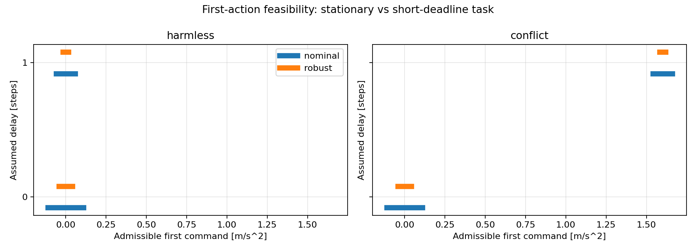

# 两个任务相关延迟歧义场景：验证报告

日期：2026-11-04。结果：保持任务存在共同鲁棒控制；短期限移动任务中，两个模型分别鲁棒可行，但第一步动作发生冲突。

## 设置与结果

完整方程、边界和证明见 [问题定义](TASK_AMBIGUITY_PROBLEM_DEFINITION.md)。两场景的系统、历史、输入约束、外扰和噪声边界完全相同，只改变终点目标。候选 d=0/1 均与六步历史相容。预测两步，即 0.1 s。

| Scenario | d=0 robust first-action interval | d=1 robust first-action interval | Common robust plan |
|---|---|---|---|
| harmless | [-0.041, 0.041] | [-0.018, 0.018] | True |
| conflict | [-0.041, 0.041] | [1.582, 1.618] | False |

Source SHA-256: `8c6346153bb6f6625636c0c20ca8565062db88b63b2d2817f1ee12e92f69a247`.

Environment: Python 3.12.14, NumPy 2.3.5, SciPy 1.18.1; scipy.optimize.linprog / HiGHS. No random sampling is used.

区间单位为 m/s²，列出的是鲁棒开环计划在第一步动作上的精确 LP 投影，不是经验阈值。当前状态和扰动外包络导致的终点半径为 0.00012 m 和 0.0021 m/s。

## 独立核验

保持目标为 (0,0)，共同零输入在全部不确定性下满足终点要求。冲突目标为 (0.002 m,0.08 m/s)，单模型显式序列 (0,1.6) 与 (1.6,0) 分别鲁棒满足要求。

不用求解器也可证明冲突：无扰动、精确状态条件下，d=0 必须 u0∈[−0.11,0.11]，d=1 必须 u0∈[1.54,1.66]。必要区间间隔 1.43 m/s²。无论下一步如何反馈，当前共同动作都无法同时满足两个世界的任务。

支持函数 LP 检查连续不确定集，逐步物理递推验证预测矩阵，手算必要区间独立检查 LP 结果。另保存 96 次确定性组合检查，包含两个计划假设、两个实际延迟、当前误差角点及满足变化率的扰动网格；其中正确模型计划的位置最大违反 8.13e-20 m，速度最大违反 2.6e-18 m/s（浮点舍入量级）。有限网格仅作补充，不代替支持函数证据。四项针对性测试及完整回归记录见 task_ambiguity_tests.log。

## 边界与下一步

这是构造性可行性证据，不是完整闭环控制器对比。第一步的必要动作冲突证明适用于本例的因果策略；不能将一般的共同开环计划不可行直接解释成所有反馈策略不可行。变化率约束虽写入可行性问题，但在本例支持函数上不活跃，因此本例不证明针对变化外扰的新贡献。

两步硬期限刻意放大任务差异，未校准真实硬件。未来不确定集为历史条件集的保守外包络；没有终点后的安全/稳定保证。主动辨识尚未实现，而冲突任务在当前时刻已无法保证；下一步应增加目标预告时间，检验提前获取信息能否改变任务可行性，并比较被动反馈。

## 文件与运行

代码 task_ambiguity_scenarios.py；定义/报告生成器 summarize_task_ambiguity.py；测试 test_task_ambiguity_scenarios.py。输出目录 results/task_ambiguity_scenarios 包含 summary.json、cross_model_checks.csv、first_action_sets.png；CSV 的位置和速度违反分别保留物理单位。

运行：`.\.venv\Scripts\python.exe -B task_ambiguity_scenarios.py`，然后 `.\.venv\Scripts\python.exe -B summarize_task_ambiguity.py`。测试：`.\.venv\Scripts\python.exe -B -m unittest -v`。既有实验结果未重跑或覆盖。
