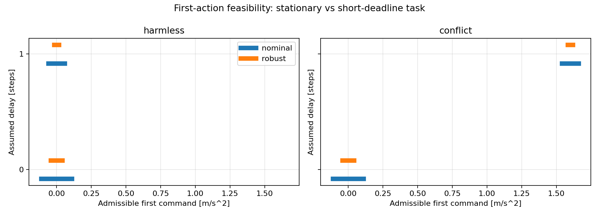

# Verification report: two task-relevant delay-ambiguity scenarios

Date: 2026-11-04. Outcome: a common robust plan exists for stationary regulation, whereas the short-deadline motion task has conflicting necessary first actions despite separate robust feasibility.

## Setup and results

See the [problem definition](TASK_AMBIGUITY_PROBLEM_DEFINITION_EN.md) for equations, assumptions and proof. Both cases share the dynamics, history, uncertainty sets and command limits. Only the terminal goal changes. Both delays are compatible with six observed transitions. The prediction horizon is two steps (0.1 s).

| Scenario | d=0 robust first-action interval | d=1 robust first-action interval | Common robust plan |
|---|---|---|---|
| harmless | [-0.041, 0.041] | [-0.018, 0.018] | True |
| conflict | [-0.041, 0.041] | [1.582, 1.618] | False |

Source SHA-256: `8c6346153bb6f6625636c0c20ca8565062db88b63b2d2817f1ee12e92f69a247`.

Environment: Python 3.12.14, NumPy 2.3.5, SciPy 1.18.1; scipy.optimize.linprog / HiGHS. No random sampling is used.

Intervals are exact LP projections of robust open-loop plans onto the first command, in m/s². The terminal uncertainty radii are 0.00012 m and 0.0021 m/s.

## Independent verification

For target (0,0), the common zero sequence meets the task for every allowed uncertainty. For target (.002 m,.08 m/s), explicit model-specific sequences (0,1.6) and (1.6,0) robustly meet their respective tasks.

Nominal algebra independently gives necessary first-action intervals [-.11,.11] and [1.54,1.66], separated by 1.43 m/s². Identical histories force a common first action, and no second-step feedback can repair this particular contradiction.

Continuous uncertainty is checked via support-function LPs. Physical recurrences independently check the lifted prediction matrices; hand-derived intervals check the optimizer. A supplementary deterministic grid contains 96 cross-model checks using initial error corners and admissible disturbance values. Matched-model plans have maximum position violation 8.13e-20 m and velocity violation 2.6e-18 m/s, at floating-point roundoff scale. This finite grid does not replace support-function verification. Four targeted tests and the full regression record are saved in task_ambiguity_tests.log.

## Limits and next experiment

These are constructed feasibility witnesses, not a full closed-loop controller comparison. The causal impossibility follows from nominal necessary first-action conditions specific to this case, not merely from infeasibility of a common open-loop sequence. The disturbance-rate constraint is inactive in the terminal support extrema; this experiment establishes no new result about varying disturbances.

The short deadline is deliberately demanding and not hardware calibrated. Future uncertainty is a conservative outer envelope of the historical conditional set. There is no post-terminal safety/stability guarantee. Active identification has not been implemented; after the conflicting task arrives, guaranteed completion is already impossible. A subsequent experiment must introduce goal preview and test whether earlier information acquisition restores feasibility compared with passive feedback.

## Artifacts and reproduction

Implementation: task_ambiguity_scenarios.py. Definition/report generator: summarize_task_ambiguity.py. Tests: test_task_ambiguity_scenarios.py. Data: results/task_ambiguity_scenarios/summary.json, cross_model_checks.csv, first_action_sets.png. Position and velocity violations retain separate physical units.

Run `.\.venv\Scripts\python.exe -B task_ambiguity_scenarios.py`, then `.\.venv\Scripts\python.exe -B summarize_task_ambiguity.py`. Tests: `.\.venv\Scripts\python.exe -B -m unittest -v`. Historical experiment outputs were not rerun or overwritten.
